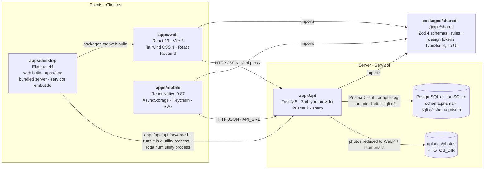
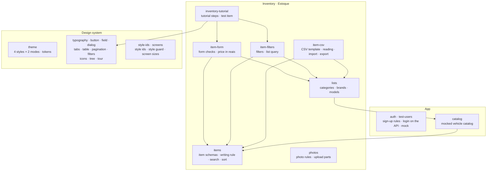
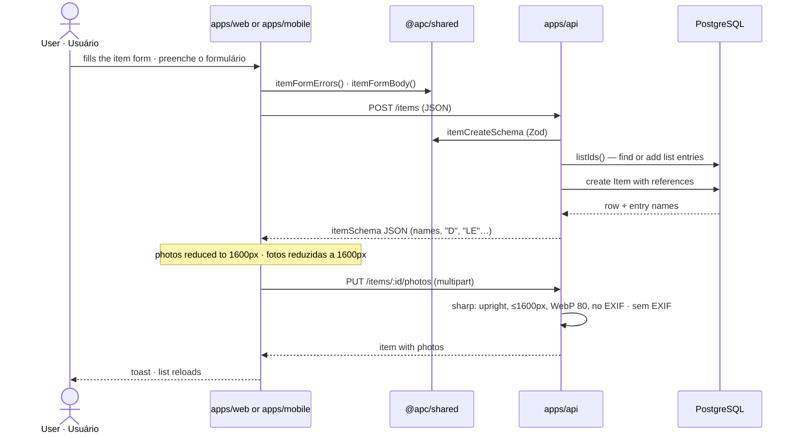
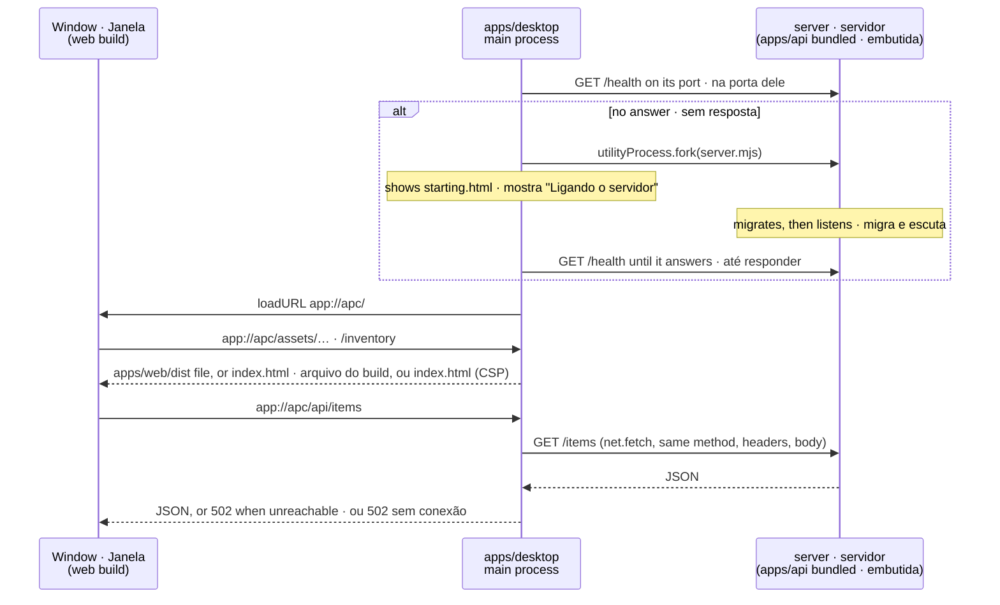
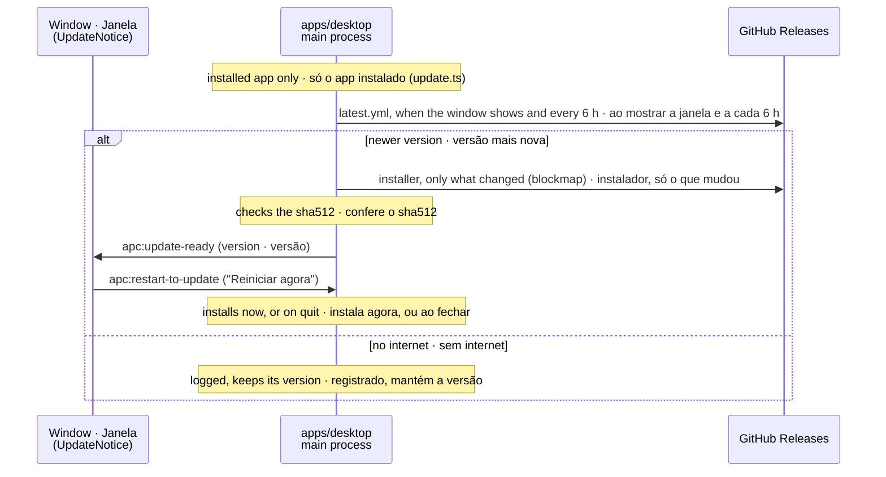
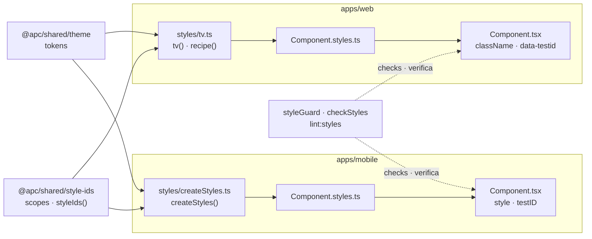

# Architecture · Arquitetura

[🇺🇸 English](#-english-us) · [🇧🇷 Português](#-português-brasil)

APC Universal Repair is a **pnpm + Turborepo** monorepo: a web app and a mobile app built on one shared package, talking to one API over HTTP. The database is described in [database.md](database.md).

O APC Universal Repair é um monorepo **pnpm + Turborepo**: um app web e um app para celular feitos sobre um pacote compartilhado, conversando com uma API por HTTP. O banco está descrito em [database.md](database.md).

## Overview · Visão geral

## Shared package · Pacote compartilhado

Everything web, mobile and API must agree on lives in `@apc/shared`, imported by subpath (e.g. `@apc/shared/items`).

Tudo em que web, celular e API precisam concordar fica no `@apc/shared`, importado por subcaminho (ex.: `@apc/shared/items`).

## Saving an item · Salvando um item

## At home · Em casa

The desktop app ships the API and runs it itself (`bundledServer.ts`, `bundledProcess.ts`): `scripts/bundle-server.mjs` bundles `apps/api/src/server.ts` with esbuild into `apps/desktop/server/server.mjs`, next to the migrations of both databases and the two native modules it can't bundle, better-sqlite3 compiled for Electron by `@electron/rebuild` (its releases have no prebuilt binary for Electron 44) and sharp. The installer ships the folder as `resources/server`. The app starts it in an Electron utility process on port 3000 (`SERVER_PORT` of `@apc/shared/server`, apart from the 3333 a development API listens on), with the SQLite file and the photos in `%APPDATA%\APC Universal Repair\data` and its log in `logs/api.log`, beside `logs/app.log`, where the main process and the updater write (`logs.ts`). A server that stops is started again a few times, and then given up (`supervisor.ts`): the window then says *O servidor não ligou*, with the last error of its log (`serverFailure.ts`), and *Tentar de novo*. Quitting waits for the server to exit. *Reiniciar agora* shows *Atualizando o APC…* and leaves `installing-update.json` in userData, so an app opened during the install leaves it alone (`update.ts`). The server applies its pending migrations on start with the API's own runner (`src/db/migrate.ts`), so an update of the app updates the server and its database together. Closing the window hides it in the tray (`tray.ts`), with the server still on, until *Sair* in the tray's menu quits the app and stops the server; the menu also shows the phone's address, picked from the network adapters, the Wi-Fi first. The installed app can start with Windows, hidden, with `--hidden` (`startup.ts`): the installer's *Iniciar com o Windows* page leaves its answer in `installer-startup.txt`, which the app applies with `app.setLoginItemSettings`, and the tray's menu changes it later. A server already answering on the port is used as it is, and an address in `config.json` (`apiUrl`) points the app at a server on another computer, when it runs none. The server runs on SQLite, or on PostgreSQL at an address the web app's *Servidor* dialog gives through the preload (`serverSettings.ts`): the app checks and migrates it first with `server/tasks.mjs`, the API's database tasks (`src/db/tasks.ts`) bundled beside the server and run each in a utility process of its own (`serverTasks.ts`), and keeps the address in `config.json` sealed by Electron's `safeStorage` (DPAPI). On SQLite the file is encrypted, with SQLite3 Multiple Ciphers in place of better-sqlite3, by a key the app makes once, keeps sealed the same way and hands the server in `APC_SQLITE_KEY` (`src/db/cipher.ts`); the dialog shows its recovery copy until the user keeps it. With PostgreSQL chosen at install and no address yet, the server waits until the dialog gives one. The same dialog imports an old server, a PostgreSQL database or a SQLite file, with its photos, into the empty database in use (`src/db/import.ts`, built on `db:copy`'s copy), with the server off meanwhile. The server listens on `0.0.0.0`, so the phone reaches it over the Wi-Fi at `http://<ip>:3000`. The installer asks which database on its *Banco de dados* page (`build/installer.nsh`), and the app keeps the choice in `config.json` (`database.ts`). The steps are in [home-server.md](home-server.md).

O app desktop traz a API e a roda sozinho (`bundledServer.ts`, `bundledProcess.ts`): o `scripts/bundle-server.mjs` junta o `apps/api/src/server.ts` com o esbuild em `apps/desktop/server/server.mjs`, ao lado das migrações dos dois bancos e dos dois módulos nativos que ele não junta, o better-sqlite3 compilado para o Electron pelo `@electron/rebuild` (as releases dele não têm binário pronto para o Electron 44) e o sharp. O instalador leva a pasta como `resources/server`. O app a liga num utility process do Electron na porta 3000 (o `SERVER_PORT` do `@apc/shared/server`, separada da 3333 em que escuta uma API de desenvolvimento), com o arquivo SQLite e as fotos em `%APPDATA%\APC Universal Repair\data` e o log em `logs/api.log`, ao lado do `logs/app.log`, onde o processo principal e o atualizador escrevem (`logs.ts`). Um servidor que para é ligado de novo algumas vezes, e depois deixado desligado (`supervisor.ts`): a janela então diz *O servidor não ligou*, com o último erro do log dele (`serverFailure.ts`), e *Tentar de novo*. Sair espera o servidor terminar. O *Reiniciar agora* mostra *Atualizando o APC…* e deixa o `installing-update.json` no userData, para um app aberto durante a instalação não mexer nela (`update.ts`). O servidor aplica as migrações pendentes ao ligar, com o executor próprio da API (`src/db/migrate.ts`), então uma atualização do app atualiza o servidor e o banco juntos. Fechar a janela a esconde na bandeja (`tray.ts`), com o servidor ainda ligado, até o *Sair* do menu da bandeja fechar o app e desligar o servidor; o menu também mostra o endereço do celular, escolhido entre os adaptadores de rede, o Wi-Fi primeiro. O app instalado pode ligar com o Windows, escondido, com `--hidden` (`startup.ts`): a página *Iniciar com o Windows* do instalador deixa a resposta em `installer-startup.txt`, que o app aplica com `app.setLoginItemSettings`, e o menu da bandeja a muda depois. Um servidor que já responde na porta é usado como está, e um endereço no `config.json` (`apiUrl`) aponta o app para um servidor em outro computador, quando ele não roda nenhum. O servidor roda no SQLite, ou no PostgreSQL num endereço que o diálogo *Servidor* do app web passa pelo preload (`serverSettings.ts`): o app o confere e migra antes com o `server/tasks.mjs`, as tarefas de banco da API (`src/db/tasks.ts`) juntadas ao lado do servidor e rodadas cada uma num utility process próprio (`serverTasks.ts`), e guarda o endereço no `config.json` lacrado pelo `safeStorage` do Electron (DPAPI). No SQLite o arquivo é criptografado, com o SQLite3 Multiple Ciphers no lugar do better-sqlite3, por uma chave que o app cria uma vez, guarda lacrada do mesmo jeito e passa ao servidor no `APC_SQLITE_KEY` (`src/db/cipher.ts`); o diálogo mostra a cópia de recuperação dela até o usuário guardá-la. Com o PostgreSQL escolhido na instalação e ainda sem endereço, o servidor espera o diálogo passar um. O mesmo diálogo importa um servidor antigo, um banco PostgreSQL ou um arquivo SQLite, com as fotos, para o banco em uso vazio (`src/db/import.ts`, feito sobre a cópia do `db:copy`), com o servidor desligado enquanto isso. O servidor escuta em `0.0.0.0`, para o celular chegar a ele pelo Wi-Fi em `http://<ip>:3000`. O instalador pergunta qual banco na página *Banco de dados* (`build/installer.nsh`), e o app guarda a escolha no `config.json` (`database.ts`). Os passos estão em [home-server.md](home-server.md#-português-brasil).

## Desktop app · App desktop

The desktop app loads the web build from its own `app://apc` protocol, so routes, assets and `localStorage` work as in the browser and keep one origin across restarts. `/api/*` is forwarded to the API address: the server it ships (`http://127.0.0.1:3000`), or the one `APC_API_URL` or `config.json` in userData names. The web code is unchanged and the API needs no CORS. The window opens at 1280×720 of content, or smaller on a screen whose work area above the taskbar doesn't hold it, down to 1280×640 (`window.ts`). It has no Node access, no permissions and can't navigate away; external links open in the system browser. Its only bridge is the preload (`preload.cts`, CommonJS so it runs in the sandbox): the page asks for a Windows notification of each error and warning, low-stock ones included, and the main process shows it only while the window isn't focused, after checking it carries just a title and a message (`notify.ts`); clicking it brings the window up with the bell's menu open. Through it the page also reads and changes the settings of the server the app runs, and the main process answers only the app's own page. The installed app also updates itself, as below.

O app desktop carrega o build da web pelo próprio protocolo `app://apc`, então rotas, arquivos e o `localStorage` funcionam como no navegador e mantêm uma só origem entre reinícios. O `/api/*` é encaminhado para o endereço da API: o servidor que ele traz (`http://127.0.0.1:3000`), ou o que o `APC_API_URL` ou o `config.json` no userData indicam. O código da web não muda e a API não precisa de CORS. A janela abre com 1280×720 de conteúdo, ou menor numa tela cuja área acima da barra de tarefas não a comporta, até 1280×640 (`window.ts`). Ela não tem acesso ao Node nem permissões e não navega para fora; links externos abrem no navegador do sistema. A única ponte é o preload (`preload.cts`, CommonJS para rodar no sandbox): a página pede uma notificação do Windows para cada erro e aviso, os de estoque baixo inclusive, e o processo principal só a mostra enquanto a janela não está em foco, depois de conferir que ela traz só um título e uma mensagem (`notify.ts`); clicar nela traz a janela para a frente com o menu do sino aberto. Por ela a página também lê e muda as configurações do servidor que o app roda, e o processo principal só responde à própria página do app. O app instalado também se atualiza sozinho, como abaixo.

On Windows the window names its id and icon itself (`identity.ts`): the installer's `com.apc.universalrepair` and the exe's icon once packaged, or `com.apc.universalrepair.dev` and `build/icon.ico` from the clone. Electron gives a run from the clone a Start menu shortcut with its own atom icon, the first time it shows a notification, and Windows takes the taskbar icon of every window under an id from its shortcut; with an id of its own, that shortcut never stands for the installed app.

No Windows a janela informa o próprio id e ícone (`identity.ts`): o `com.apc.universalrepair` do instalador e o ícone do exe quando empacotada, ou o `com.apc.universalrepair.dev` e o `build/icon.ico` rodando do clone. O Electron dá a um app rodando do clone um atalho no menu Iniciar com o ícone de átomo dele, na primeira notificação que mostra, e o Windows tira do atalho o ícone na barra de tarefas de toda janela com aquele id; com um id próprio, esse atalho nunca representa o app instalado.

### Updates · Atualizações

The installed app checks the repository's GitHub Releases with `electron-updater`: once its window shows, so it never delays opening, then every 6 hours. It doesn't check in development (`APC_DEV_URL`), unpackaged or as the portable exe (`checksForUpdates` in `update.ts`). A newer version is downloaded in the background, only the blocks that changed, and checked against the sha512 in `latest.yml`; the builds are unsigned, so no publisher signature is asked for. The main process then tells the page through the preload, which keeps the version for a page that subscribes later, and the web app's `UpdateNotice`, drawn only when the bridge exists, shows *Nova versão X pronta*. The version goes in silently when the app quits, or at once through `restartToUpdate`, which the main process only takes from the app's own page. A failed check is logged and the app keeps its version. A newer installer run by hand upgrades the app in place: the NSIS installer finds it by the `appId` and keeps the data in `%APPDATA%`.

O app instalado consulta as GitHub Releases do repositório com o `electron-updater`: quando a janela aparece, para nunca atrasar a abertura, e depois a cada 6 horas. Ele não consulta em desenvolvimento (`APC_DEV_URL`), sem empacotar nem como exe portátil (`checksForUpdates` em `update.ts`). Uma versão mais nova é baixada em segundo plano, só os blocos que mudaram, e conferida com o sha512 do `latest.yml`; os builds não são assinados, então nenhuma assinatura de editor é pedida. O processo principal então avisa a página pelo preload, que guarda a versão para uma página que se inscreva depois, e o `UpdateNotice` do app web, desenhado só quando a ponte existe, mostra *Nova versão X pronta*. A versão entra em silêncio quando o app fecha, ou na hora pelo `restartToUpdate`, que o processo principal só aceita da própria página do app. Uma consulta que falha é registrada e o app mantém a versão. Um instalador mais novo rodado na mão atualiza o app no lugar: o instalador NSIS o encontra pelo `appId` e mantém os dados em `%APPDATA%`.

### Server version · Versão do servidor

The web build inside the desktop app expects the API of the same version. The server the app ships is always on it, since they install and update together. `/health` answers the API's version (`apps/api/package.json`, kept equal to the desktop app's: the Desktop workflow refuses a release where they differ, `scripts/release-version.ts`, and the bundled server takes the app's through `APC_API_VERSION`). For a server on another computer (`apiUrl`), the installed app compares the two once the window shows and, when they differ, or the server answers none as before 0.2.0, only shows a warning (`serverVersionWarning` in `update.ts`): it never changes a server it doesn't run. Development, unpackaged and portable runs skip the check, since they aren't on a release.

O build da web dentro do app desktop espera a API da mesma versão. O servidor que o app traz está sempre nela, já que os dois se instalam e se atualizam juntos. O `/health` responde a versão da API (`apps/api/package.json`, mantida igual à do app desktop: o workflow Desktop recusa uma release em que elas diferem, `scripts/release-version.ts`, e o servidor embutido recebe a do app pelo `APC_API_VERSION`). Para um servidor em outro computador (`apiUrl`), o app instalado compara as duas quando a janela aparece e, quando diferem, ou o servidor não responde nenhuma como antes da 0.2.0, só mostra um aviso (`serverVersionWarning` em `update.ts`): ele nunca mexe num servidor que não roda. Desenvolvimento, sem empacotar e o exe portátil pulam a checagem, já que não estão numa release.

## Styles · Estilos

Each component keeps its look in a recipe in its own `<Component>.styles.ts`, built from the theme tokens, which gives the classes or styles and the style id of each element. Lint fails when a component writes a style or an id by hand.

The status colors are `danger` (red), `warn` (yellow), `success` (green) and `info` (blue), each with the color drawn on it (`onDanger`, `onWarn`, `onSuccess`, `onInfo`), in every style and mode; toasts and notifications tell their kinds apart by them. Where a style's accent is green (Fiat 90) or blue (GT4), success is a teal green and info an indigo, set apart from it. On web they are the `bg-success`, `text-on-success`… classes.

Toasts have a kind (`@apc/shared/toast`): success, error, info and warning, each in its status color with its icon (a check, an X, an "i" and a "!" in a triangle), so the kind is never told by color alone. `useToast()` gives a function per kind, `toast.success(…)`, on web and mobile. Errors and warnings are read out at once (an alert on web); successes and infos after what the screen reader is saying. A toast fades in rising a little and fades out in `TOAST_FADE_MS`, the app's motion duration (CSS transitions from `@starting-style` on web, `Animated` on the native driver on mobile); a new one takes the place of the one showing, which fades out under it, hidden from screen readers. With reduced motion they show and hide at once. An edit saved with nothing changed isn't sent, and an info toast says so.

The bell to the left of the user menu keeps the toasts (`@apc/shared/notifications`): the provider lets the bell hear each one (`useToastFeed`), and the last 20 are kept, newest first, on the device under a key for each user (`apc-notifications:<user id>`, in localStorage on web and AsyncStorage on mobile), so they survive a reload and another user on the same device doesn't see them. A badge counts the unread ("9+" above nine); opening the menu marks them all read, and "Limpar notificações" empties it. The gear in its header sets how long a toast stays (`TOAST_DURATION`: 5 s by default, 2 s to 15 s, a second at a time), which the toast provider holds and saves on the device (`apc-toast-duration`).

Each time the Inventory's stock loads, the items newly at or below their minimum (out of stock included, as the rows' tints show them) raise one warning, e.g. "Estoque baixo: “Filtro de óleo” (2 de 3)" or "Estoque baixo em 4 itens" (`lowStockAlerts`). An item is warned about once while it stays low; the ids already warned about are kept on the device for each user (`apc-low-stock:<user id>`). The load as the Inventory opens only adds the warning to the bell (`useNotify`); a later one, after a save or an import, also shows it as a toast.

Cada componente guarda a aparência numa receita no seu próprio `<Componente>.styles.ts`, feita dos tokens do tema, que dá as classes ou estilos e o id de estilo de cada elemento. O lint falha quando um componente escreve um estilo ou um id à mão.

As cores de status são `danger` (vermelho), `warn` (amarelo), `success` (verde) e `info` (azul), cada uma com a cor do que vai sobre ela (`onDanger`, `onWarn`, `onSuccess`, `onInfo`), em todos os estilos e modos; toasts e notificações distinguem seus tipos por elas. Onde o destaque do estilo é verde (Fiat 90) ou azul (GT4), o sucesso é um verde-azulado e a informação um anil, afastados dele. Na web elas são as classes `bg-success`, `text-on-success`…

Os toasts têm um tipo (`@apc/shared/toast`): sucesso, erro, informação e aviso, cada um na sua cor de status com o seu ícone (um check, um X, um "i" e um "!" num triângulo), para o tipo nunca depender só da cor. O `useToast()` dá uma função por tipo, `toast.success(…)`, na web e no celular. Erros e avisos são lidos na hora (um alerta na web); sucessos e informações depois do que o leitor de tela está falando. Um toast aparece subindo um pouco e some esmaecendo em `TOAST_FADE_MS`, a duração de movimento do app (transições CSS a partir do `@starting-style` na web, `Animated` no driver nativo no celular); um novo toma o lugar do que está aparecendo, que esmaece por baixo dele, escondido dos leitores de tela. Com movimento reduzido eles aparecem e somem na hora. Uma edição salva sem mudanças não é enviada, e um toast de informação diz isso.

O sino à esquerda do menu do usuário guarda os toasts (`@apc/shared/notifications`): o provider deixa o sino ouvir cada um (`useToastFeed`), e os últimos 20 ficam, do mais novo ao mais antigo, no aparelho sob uma chave para cada usuário (`apc-notifications:<id do usuário>`, no localStorage na web e no AsyncStorage no celular), então continuam depois de recarregar e outro usuário no mesmo aparelho não os vê. Um selo conta os não lidos ("9+" acima de nove); abrir o menu marca todos como lidos, e "Limpar notificações" esvazia a lista. A engrenagem no cabeçalho dele define quanto tempo um toast fica na tela (`TOAST_DURATION`: 5 s por padrão, de 2 s a 15 s, de um em um segundo), que o provider dos toasts guarda e salva no aparelho (`apc-toast-duration`).

Cada vez que o estoque do Estoque carrega, os itens que acabaram de chegar ao mínimo ou abaixo dele (esgotados inclusive, como as cores das linhas mostram) geram um aviso, por exemplo "Estoque baixo: “Filtro de óleo” (2 de 3)" ou "Estoque baixo em 4 itens" (`lowStockAlerts`). Um item é avisado uma vez enquanto continua baixo; os ids já avisados ficam no aparelho para cada usuário (`apc-low-stock:<id do usuário>`). A carga ao abrir o Estoque só põe o aviso no sino (`useNotify`); uma carga depois, após salvar ou importar, também o mostra como toast.

| Scope · Escopo | Covers · Cobre |
|---|---|
| `common` | The design system · O design system |
| `auth` | The login · O login |
| `dashboard` | The shell around the tabs · A moldura em volta das abas |
| `catalog` | The Catalog tab · A aba Catálogo |
| `inventory` | The Inventory tab and its dialogs · A aba Estoque e seus diálogos |
| `docs` | Storybook-only pages · Páginas só do Storybook |

An id reads `<scope>.<component>[.<slot>…]`, e.g. `common.dialog.header.close`, the same on web and mobile. See "Styles" in [AGENTS.md](../AGENTS.md).

Um id é `<escopo>.<componente>[.<slot>…]`, ex.: `common.dialog.header.close`, igual na web e no celular. Veja "Styles" no [AGENTS.md](../AGENTS.md).

---

## 🇺🇸 English (US)

### Parts

| Part | What it does | Main technologies |
|---|---|---|
| `packages/shared` | The contract and the rules: Zod schemas of every request and response, the writing rule, search and sort, form checks, CSV reading and writing, design tokens of the 4 styles and 2 modes. No UI, so web and mobile behave the same. | TypeScript, Zod 4 |
| `apps/web` | The web app: login and sign-up, Dashboard with the Inventory and Catalog tabs, design system components. | React 19, Vite 8, Tailwind CSS 4, React Router 8, Storybook 10 |
| `apps/mobile` | The phone app, the same screens with React Native components. | React Native 0.87, AsyncStorage, react-native-keychain, react-native-svg, image and document pickers |
| `apps/desktop` | The Windows desktop app: the web build in an Electron window, the API forwarded through `app://apc`, and the local API started when it doesn't answer. | Electron 44, electron-builder (NSIS and portable) |
| `apps/api` | The REST API: users (sign-up and login), items, item lists, photos, CSV import. Validates every request with the shared schemas. | Fastify 5, Prisma 7 (PostgreSQL with adapter-pg, or SQLite with adapter-better-sqlite3), sharp, @fastify/multipart |
| Database | Users, sessions, items, lists and photo records, on PostgreSQL or SQLite, the same models in both. Photo files stay on disk under `PHOTOS_DIR`. | PostgreSQL or SQLite, Prisma migrations for each |

### How they talk

- Web and mobile call the API over HTTP with JSON; the web goes through the Vite dev server's `/api` proxy, the phone straight to `API_URL`.
- At home, the API runs on a Windows computer and the phone reaches it over the Wi-Fi (see [home-server.md](home-server.md)).
- Both sides use the same Zod schemas from `@apc/shared`, so a field can't mean one thing in the app and another in the API.
- The API speaks names (`"Motor"`, `"D"`); the database keeps references and enums (see [database.md](database.md)).
- Sign-up (`POST /users`) and login (`POST /sessions`) go to the API, which keeps the users and checks the password against its hash, and starts a session: it answers the user and a random token, keeping only the token's SHA-256 in `Session`. The app saves both as the session on the device (localStorage on the web and the desktop, the keychain on the phone), and `apiFetch` (`@apc/shared/auth`) sends the token on every call as `Authorization: Bearer <token>`. An `onRequest` hook (`plugins/authenticate.ts`) answers 401 to any route without a live session, before the body is read; only `GET /health`, the login and the sign-up are open. A session lasts 7 days from its last use, written at most once an hour, and `DELETE /sessions/current` ends it on "Sair". A 401 to a call that carried the token clears the session on the device, and the login says it expired. Photos are loaded by `` and `<Image>`, which can't send a header, so the API answers each photo path signed for the caller's session (`?session=<id>&signature=<HMAC>`), which `GET /photos/:file` checks, and which stops working when the session ends. The session says whether the user has seen the Inventory tutorial, which runs by itself on their first login only, and `PUT /users/me/inventory-tutorial` marks it for the caller once it starts.
- The API answers only requests addressed to this computer (`plugins/allowed-hosts.ts`): a `Host` of `localhost`, a loopback address, an address of its network interfaces (read again when a `Host` isn't known, so a new Wi-Fi address works), `10.0.2.2` for the Android emulator, or a name in `APC_ALLOWED_HOSTS`, with any port. Anything else answers 403 before the session is looked at, which closes DNS rebinding: a page whose domain resolves to `127.0.0.1` still sends its domain as the `Host`. The Vite proxy and the desktop app send the API's own address.
- Login and sign-up attempts are counted in memory, in 15-minute windows (`users/attempts.ts`): 5 wrong passwords for one username from one address block it there, without checking the password, until the window ends or a right one clears the count; an address gets 30 logins and 10 sign-ups in all. Past a limit the API answers 429 with `Retry-After`, never saying whether the username exists, and the apps say how many minutes to wait. The desktop app and the web's dev server call from the computer itself, so they share its address.

### Tooling

| Concern | Tool |
|---|---|
| Monorepo, tasks and cache | pnpm 12 workspaces, Turborepo 2 |
| Language | TypeScript 5–6 |
| Lint | ESLint with typescript-eslint (shared, API, mobile), oxlint (web), and the style guard (`lint:styles`) on web and mobile |
| Shared and API tests | Node test runner (`node --test`, `tsx --test`) |
| Web component tests | Vitest 5 Browser Mode in Chromium |
| Web end-to-end tests | Playwright, at 1280×720 and 360×780 |
| Mobile tests | Jest with react-test-renderer |
| Design system catalog | Storybook 10 |
| Desktop app tests | Node test runner, and Playwright's Electron support for the smoke test |
| Style recipes | tailwind-variants with tailwind-merge (web), `createStyles` over `StyleSheet` (mobile), both giving style ids |
| CI | GitHub Actions: lint, typecheck, build, tests and E2E on every pull request |

---

## 🇧🇷 Português (Brasil)

### Partes

| Parte | O que faz | Principais tecnologias |
|---|---|---|
| `packages/shared` | O contrato e as regras: schemas Zod de cada requisição e resposta, a regra de escrita, busca e ordenação, as validações do formulário, a leitura e a escrita do CSV e os tokens de design dos 4 estilos e 2 modos. Sem interface, para web e celular funcionarem igual. | TypeScript, Zod 4 |
| `apps/web` | O app web: login e cadastro, Dashboard com as abas Estoque e Catálogo, componentes do design system. | React 19, Vite 8, Tailwind CSS 4, React Router 8, Storybook 10 |
| `apps/mobile` | O app para celular, com as mesmas telas em componentes React Native. | React Native 0.87, AsyncStorage, react-native-keychain, react-native-svg, seletores de imagem e de documentos |
| `apps/desktop` | O app desktop para Windows: o build da web numa janela do Electron, a API encaminhada pelo `app://apc` e a API local ligada quando não responde. | Electron 44, electron-builder (NSIS e portátil) |
| `apps/api` | A API REST: usuários (cadastro e login), itens, listas, fotos e importação de CSV. Valida cada requisição com os schemas compartilhados. | Fastify 5, Prisma 7 (PostgreSQL com adapter-pg, ou SQLite com adapter-better-sqlite3), sharp, @fastify/multipart |
| Banco | Usuários, sessões, itens, listas e os registros das fotos, em PostgreSQL ou SQLite, com os mesmos modelos nos dois. Os arquivos das fotos ficam em disco, em `PHOTOS_DIR`. | PostgreSQL ou SQLite, migrações do Prisma para cada um |

### Como conversam

- Web e celular chamam a API por HTTP com JSON; a web passa pelo proxy `/api` do servidor do Vite, o celular vai direto ao `API_URL`.
- Em casa, a API roda num computador Windows e o celular chega a ela pelo Wi-Fi (veja [home-server.md](home-server.md#-português-brasil)).
- Os dois lados usam os mesmos schemas Zod do `@apc/shared`, então um campo não pode significar uma coisa no app e outra na API.
- A API fala em nomes (`"Motor"`, `"D"`); o banco guarda referências e enums (veja [database.md](database.md)).
- O cadastro (`POST /users`) e o login (`POST /sessions`) vão para a API, que guarda os usuários, confere a senha com o hash dela e abre uma sessão: ela responde o usuário e um token aleatório, guardando só o SHA-256 do token em `Session`. O app salva os dois como a sessão no aparelho (localStorage na web e no desktop, o keychain no celular), e o `apiFetch` (`@apc/shared/auth`) envia o token em toda chamada como `Authorization: Bearer <token>`. Um hook `onRequest` (`plugins/authenticate.ts`) responde 401 a qualquer rota sem uma sessão válida, antes de ler o corpo; só o `GET /health`, o login e o cadastro ficam abertos. Uma sessão dura 7 dias desde o último uso, gravado no máximo uma vez por hora, e o `DELETE /sessions/current` a encerra no "Sair". Um 401 a uma chamada que levou o token limpa a sessão no aparelho, e o login avisa que ela expirou. As fotos são carregadas por `` e `<Image>`, que não enviam cabeçalho, então a API responde cada caminho de foto assinado para a sessão de quem chamou (`?session=<id>&signature=<HMAC>`), que o `GET /photos/:file` confere e que para de funcionar quando a sessão termina. A sessão diz se o usuário já viu o tutorial do Estoque, que só roda sozinho no primeiro login dele, e o `PUT /users/me/inventory-tutorial` o marca para quem chamou assim que ele começa.
- A API só responde a requisições endereçadas a este computador (`plugins/allowed-hosts.ts`): um `Host` igual a `localhost`, um endereço de loopback, um endereço das interfaces de rede dele (lidos de novo quando um `Host` não é conhecido, então um endereço novo do Wi-Fi funciona), `10.0.2.2` para o emulador do Android, ou um nome do `APC_ALLOWED_HOSTS`, com qualquer porta. O resto responde 403 antes de a sessão ser conferida, o que fecha o DNS rebinding: uma página cujo domínio aponta para `127.0.0.1` ainda envia o domínio dela como `Host`. O proxy do Vite e o app desktop enviam o endereço da própria API.
- As tentativas de login e cadastro são contadas na memória, em janelas de 15 minutos (`users/attempts.ts`): 5 senhas erradas para um usuário a partir de um endereço o bloqueiam ali, sem conferir a senha, até a janela acabar ou uma senha certa zerar a contagem; um endereço tem 30 logins e 10 cadastros no total. Passando de um limite, a API responde 429 com `Retry-After`, sem nunca dizer se o usuário existe, e os apps dizem quantos minutos esperar. O app desktop e o servidor de desenvolvimento da web chamam do próprio computador, então dividem o endereço dele.

### Ferramentas

| Assunto | Ferramenta |
|---|---|
| Monorepo, tarefas e cache | workspaces do pnpm 12, Turborepo 2 |
| Linguagem | TypeScript 5–6 |
| Lint | ESLint com typescript-eslint (shared, API, celular), oxlint (web), e a verificação de estilos (`lint:styles`) na web e no celular |
| Testes do shared e da API | Test runner do Node (`node --test`, `tsx --test`) |
| Testes de componente da web | Vitest 5 Browser Mode no Chromium |
| Testes de ponta a ponta da web | Playwright, em 1280×720 e 360×780 |
| Testes do celular | Jest com react-test-renderer |
| Catálogo do design system | Storybook 10 |
| Testes do app desktop | Test runner do Node, e o suporte a Electron do Playwright no smoke test |
| Receitas de estilo | tailwind-variants com tailwind-merge (web), `createStyles` sobre o `StyleSheet` (celular), as duas dando os ids de estilo |
| CI | GitHub Actions: lint, typecheck, build, testes e E2E em todo pull request |
