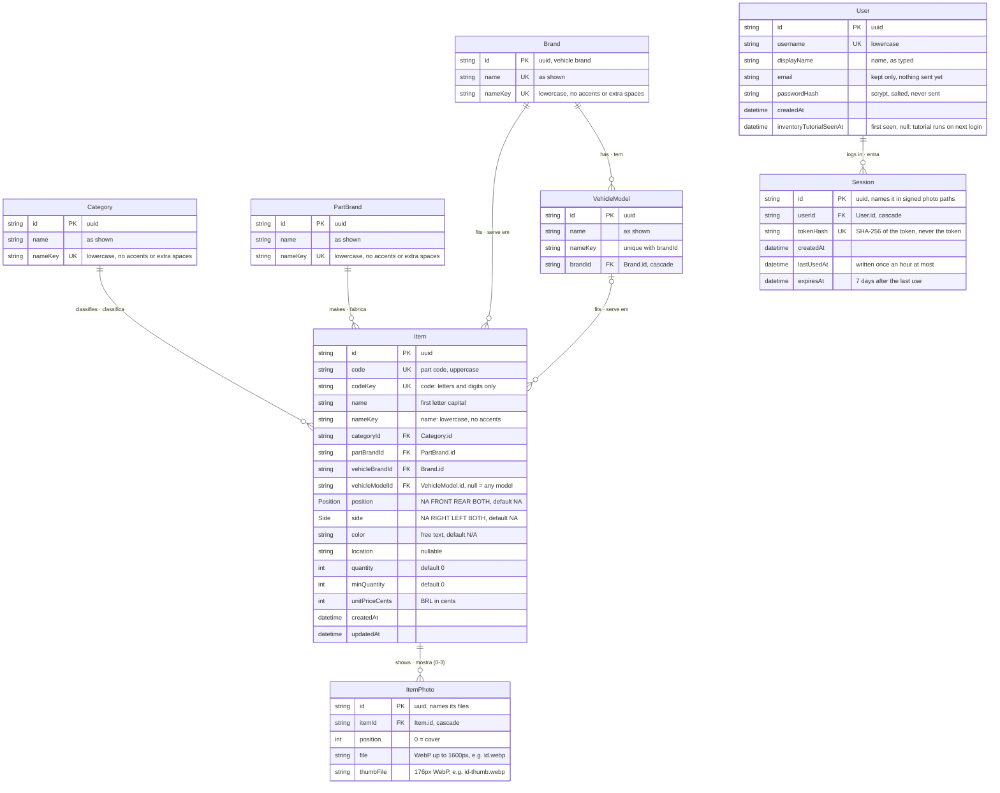

# Database · Banco de dados

[🇺🇸 English](#-english-us) · [🇧🇷 Português](#-português-brasil)

The inventory's PostgreSQL database, defined in [`apps/api/prisma/schema.prisma`](../apps/api/prisma/schema.prisma) and changed only through the migrations in [`apps/api/prisma/migrations`](../apps/api/prisma/migrations).

O banco PostgreSQL do estoque, definido em [`apps/api/prisma/schema.prisma`](../apps/api/prisma/schema.prisma) e alterado só pelas migrações em [`apps/api/prisma/migrations`](../apps/api/prisma/migrations).

## Diagram · Diagrama

---

## 🇺🇸 English (US)

### Entities

| Table | What it holds |
|---|---|
| `Item` | An inventory item: a part in stock, with its part code, the list entries it belongs to, where it fits on the vehicle, how many there are and its unit price. |
| `ItemPhoto` | Up to 3 photos of an item, in order; the first one is the cover in the list. The files themselves are stored by the API under `PHOTOS_DIR`, each photo reduced to a WebP of up to 1600px next to its thumbnail. |
| `Category` | The categories an item is filed under (Motor, Freios…). |
| `PartBrand` | The brands of the parts (Bosch, NGK…). |
| `Brand` | The vehicle brands (Chevrolet, Volkswagen…), shared with the catalog. |
| `VehicleModel` | The models of each vehicle brand (Opala, Gol…). |
| `User` | Who logs in: their username, name, e-mail (kept only, nothing is sent to it yet), the hash of their password, and when they first saw the Inventory tutorial, which runs by itself only until then, on any device. It has no relation to the inventory tables. |
| `Session` | A user logged in on one device, from a login or sign-up until "Sair" or 7 days without use: the hash of the token the device sends, and when it was last used and expires. |

### Relationships

- Every item has **one** category, part brand and vehicle brand, and **at most one** vehicle model. An item without a vehicle model fits **any model** of its vehicle brand.
- A vehicle model belongs to **one** vehicle brand; a vehicle brand has **many** models.
- An item has **0 to 3** photos (the limit is checked by the API).
- The item stores **references** (`categoryId`, …), not names: renaming a list entry renames it on every item at once.

### Rules

| Rule | Where |
|---|---|
| Names are unique ignoring case, accents and extra spaces: `nameKey` holds the name in that form and is unique (a vehicle model's within its brand). | `Category`, `PartBrand`, `Brand`, `VehicleModel` |
| A part code is stored in uppercase and is unique as the search compares it: `codeKey`, the code with letters and digits only, is unique too, so `CB4500` and `CB-4500` can't both be in stock. `codeKey` and `nameKey` let the search ignore separators and accents. | `Item` |
| The unit price is an integer in cents, so prices add up without rounding errors. | `Item.unitPriceCents` |
| `position`, `side` and `color` default to "not applicable". The API speaks `N/A`, `D`, `T`, `Ambos` (position) and `N/A`, `LD`, `LE`, `Ambos` (side); the database keeps them as the `Position` and `Side` enums. | `Item` |
| Stock status isn't stored: an item is out of stock at 0 and low at or under its minimum. | `Item.quantity`, `Item.minQuantity` |
| A list entry an item uses can't be deleted (`RESTRICT`); deleting a vehicle brand deletes its models (`CASCADE`); deleting an item deletes its photos (`CASCADE`). | Foreign keys |
| Vehicle brands of the catalog can't be deleted from the inventory. | API |
| A username is kept in lowercase and is unique, so names that differ only in case are the same user. It takes 3 to 32 lowercase letters, digits, dots or hyphens. | `User.username`, API |
| A password is never kept as typed: `passwordHash` holds `scrypt$<salt>$<hash>` with a random salt per user, and the API never sends it. | `User.passwordHash` |
| A token is never kept: `tokenHash` holds its SHA-256, so the table alone can't be used to log in. An expired session is deleted when it is next looked up; deleting a user deletes their sessions (`CASCADE`). | `Session` |

### Migrations

- **Two schemas, the same models.** The database runs on PostgreSQL (`prisma/schema.prisma`, `prisma/migrations`) or SQLite (`prisma/sqlite/schema.prisma`, `prisma/sqlite/migrations`). A change to the database goes in both schemas, each with its own migration, in the same pull request; `pnpm --filter @apc/api lint` fails when their models differ (`db:check-schemas`).
- **The API's own migration runner.** `src/db/migrate.ts` applies each pending migration's `migration.sql` whole, in one transaction, through the database's own driver (pg, better-sqlite3), and records it in `_prisma_migrations` as `prisma migrate deploy` does: a random id, the SHA-256 of the file and when it started and finished. A database migrated either way is the same to the other; `prisma migrate status` agrees. A migration that fails, or one recorded as started and never finished, stops the run. The server the desktop app ships runs it on start (`APC_MIGRATE_ON_START=1`), so it needs no Prisma CLI.
- **The same commands on both.** `pnpm --filter @apc/api db:migrate` applies the pending migrations of the database `DATABASE_URL` names, with that runner, and `db:check` fails when that database doesn't match its schema. To write a new migration, run `prisma migrate dev --name <change>` once with a PostgreSQL `DATABASE_URL`, and once with `--config prisma.sqlite.config.ts` and a SQLite one.
- **An empty database migrates in one go.** `db:migrate` applies every pending migration in one database session. A new computer (see [home-server.md](home-server.md)) gets them all at once, while the computer at home took them one at a time. CI's `migrations` job builds an empty PostgreSQL and an empty SQLite file from them, checks each matches its schema, seeds it and runs the API's tests that need a database.
- **Helpers in `pg_temp` live for the session.** A migration that creates a function in `pg_temp`, such as the name-key helper `list_key`, drops it at its end, so the next one can create it again. `20261008120000_drop_list_key` drops the helper that `20261008000000_item_lists` left behind, without changing a migration already applied.
- **An applied migration never changes.** A fix goes into a new migration. Even one dated between older ones is applied on a database that has the later ones, as long as it is harmless there.

### SQLite

The same database also runs on SQLite, chosen by `DATABASE_URL`: `file:./data/apc.db` opens a file, read from `apps/api`, and `postgresql://…` PostgreSQL. One server uses one of them; the data is never written to both.

| | SQLite | PostgreSQL |
|---|---|---|
| Pick it for | One computer at home serving the phone and the desktop app | A database already in use, or more than one computer on the same database |
| To install | Nothing: the file is created by `db:migrate` | PostgreSQL, a password and a Windows service |
| Who reaches the data | Only this computer, through the file | Any program with its address and password; only this computer when set up so ([#215](https://github.com/ChrisCamilo/apc-universal-repair/issues/215)) |
| Backup | Copy `apps/api/data` with the server off | `pg_dump` and `pg_restore` |
| Writes at once | One at a time, which a workshop doesn't notice | Many |

[#221](https://github.com/ChrisCamilo/apc-universal-repair/issues/221) proved it, with the findings below.

- **The schema:** `prisma/sqlite/schema.prisma` is `prisma/schema.prisma` with only the provider and the client's folder changed. Its own migrations are in `prisma/sqlite/migrations`, and `prisma.sqlite.config.ts` points the Prisma CLI at them (`--config prisma.sqlite.config.ts`). `pnpm --filter @apc/api db:generate` builds both clients. The enums are kept as text and the dates as ISO text; the rules above hold the same.
- **The adapter:** `@prisma/adapter-better-sqlite3`, whose native module installs prebuilt on Windows and Linux. It keeps one connection and waits up to 5 s for a write lock held by another process. libSQL was tried too and failed with "Operation has timed out" as soon as two processes used the file, on an older SQLite (3.45 against 3.53).
- **What was checked:** every API test runs on both databases, including `test:db`, in CI's `migrations` job, once per database. That covers interactive transactions (saving an item, the import), `createMany` (photos), the low-stock filter comparing two columns, the search on `nameKey` and `codeKey`, sorting, the unique keys, `CASCADE` and `RESTRICT`, and 20 edits and 10 logins at once.
- **WAL:** the API turns on `PRAGMA journal_mode = WAL` when it starts (`prepareDatabase`), so the list is read while an item is saved; it stays on in the file, next to its `-wal` and `-shm` files.
- **One process writes:** the API is the only one, so its requests take turns on its connection. A second process writing at the same time, such as a script, can hit Prisma's 5 s transaction timeout, so scripts run with the server off and the tests on SQLite run one file at a time.
- **Moving between them:** `pnpm --filter @apc/api db:copy --from <url> --to <url>` copies every table but the sessions, in one transaction on the target, into an empty database made with `db:migrate` (`src/db/copy.ts`); the desktop app imports an old server with the same copy (see [home-server.md](home-server.md#7-importing-an-old-server)). It refuses a target that isn't empty, either database lacking a migration, and a server that answers.
- **Encrypted at rest:** the desktop app's SQLite file is encrypted (`src/db/cipher.ts`), so a copy of it is unreadable without its key.
  - **The cipher:** better-sqlite3 is installed as `better-sqlite3-multiple-ciphers` (SQLite3 Multiple Ciphers), through an override in `pnpm-workspace.yaml`, so the API, the migration runner and Prisma's adapter all use it. The file is in SQLCipher 4's format, so its key also opens it in tools that read SQLCipher, such as DB Browser for SQLite.
  - **Which file has a key:** the server's own, the one `DATABASE_URL` names, takes `APC_SQLITE_KEY`; any other file is plain unless a database task gives its key, as an import of an encrypted file does. Every connection sends the key first. Without `APC_SQLITE_KEY`, as in development, the file is plain.
  - **The key:** 32 random bytes the desktop app makes the first time it runs the server on SQLite, kept in `config.json` only sealed by Windows DPAPI (Electron's `safeStorage`), and handed to the server in `APC_SQLITE_KEY`. Its recovery copy shows in the app until the user says it is kept; without it, a copy of the file opens on no other computer or Windows user.
  - **A plain file from before:** the server encrypts it in place on its first start with a key (`PRAGMA rekey`, after switching WAL off), through a backup copy that is removed once the encrypted file reads back. A key that doesn't open the file stops the server, saying so.
  - **Migrations and checks:** `prisma migrate deploy` can't open an encrypted file, which is why the API has its own runner. `db:check` checks an encrypted file has every migration applied, and diffs a plain copy built from the same migrations against the schema. CI's `sqlite` job runs every database test on an encrypted file.

### Starting data

`pnpm --filter @apc/api db:seed` fills a new database with the test users (`christian.camilo` and `oficina`, from `@apc/shared/test-users`, with their passwords hashed), the default categories, part brands, vehicle brands with their models and a few sample items. It can run again without duplicating anything.

---

## 🇧🇷 Português (Brasil)

### Entidades

| Tabela | O que guarda |
|---|---|
| `Item` | Um item do estoque: uma peça, com o código da peça, as entradas das listas a que pertence, onde serve no veículo, quantas há e o valor unitário. |
| `ItemPhoto` | Até 3 fotos de um item, em ordem; a primeira é a capa na lista. Os arquivos ficam guardados pela API em `PHOTOS_DIR`, cada foto reduzida a um WebP de até 1600px ao lado da miniatura. |
| `Category` | As categorias dos itens (Motor, Freios…). |
| `PartBrand` | As marcas das peças (Bosch, NGK…). |
| `Brand` | As marcas de veículo (Chevrolet, Volkswagen…), as mesmas do catálogo. |
| `VehicleModel` | Os modelos de cada marca de veículo (Opala, Gol…). |
| `User` | Quem entra no app: o usuário, o nome, o e-mail (só guardado, nada é enviado a ele ainda), o hash da senha e quando viu o tutorial do Estoque pela primeira vez, que só roda sozinho até então, em qualquer aparelho. Não se relaciona com as tabelas do estoque. |
| `Session` | Um usuário logado num aparelho, de um login ou cadastro até o "Sair" ou 7 dias sem uso: o hash do token que o aparelho envia, e quando foi usada pela última vez e quando expira. |

### Relacionamentos

- Todo item tem **uma** categoria, marca de peça e marca de veículo, e **no máximo um** modelo de veículo. Um item sem modelo serve em **qualquer modelo** da marca.
- Um modelo pertence a **uma** marca de veículo; uma marca tem **vários** modelos.
- Um item tem de **0 a 3** fotos (o limite é conferido pela API).
- O item guarda **referências** (`categoryId`, …), não nomes: renomear uma entrada de lista renomeia em todos os itens de uma vez.

### Regras

| Regra | Onde |
|---|---|
| Os nomes são únicos ignorando maiúsculas, acentos e espaços a mais: `nameKey` guarda o nome nessa forma e é único (o de um modelo, dentro da marca). | `Category`, `PartBrand`, `Brand`, `VehicleModel` |
| O código da peça é guardado em maiúsculas e é único do jeito que a busca compara: `codeKey`, o código só com letras e números, também é único, então `CB4500` e `CB-4500` não podem estar os dois no estoque. `codeKey` e `nameKey` deixam a busca ignorar separadores e acentos. | `Item` |
| O valor unitário é um inteiro em centavos, para os valores somarem sem erro de arredondamento. | `Item.unitPriceCents` |
| `position`, `side` e `color` começam como "não se aplica". A API usa `N/A`, `D`, `T`, `Ambos` (posição) e `N/A`, `LD`, `LE`, `Ambos` (lado); o banco guarda nos enums `Position` e `Side`. | `Item` |
| A situação do estoque não é guardada: o item está esgotado em 0 e baixo quando está no mínimo ou abaixo. | `Item.quantity`, `Item.minQuantity` |
| Uma entrada de lista usada por um item não pode ser excluída (`RESTRICT`); excluir uma marca de veículo exclui os modelos dela (`CASCADE`); excluir um item exclui as fotos dele (`CASCADE`). | Chaves estrangeiras |
| As marcas de veículo do catálogo não podem ser excluídas pelo estoque. | API |
| O usuário é guardado em minúsculas e é único, então nomes que só mudam em maiúsculas são o mesmo usuário. Ele aceita de 3 a 32 letras minúsculas, números, pontos ou hífens. | `User.username`, API |
| A senha nunca é guardada como foi digitada: `passwordHash` guarda `scrypt$<sal>$<hash>` com um sal aleatório por usuário, e a API nunca o envia. | `User.passwordHash` |
| O token nunca é guardado: `tokenHash` guarda o SHA-256 dele, então a tabela sozinha não serve para entrar. Uma sessão expirada é apagada na próxima vez que é procurada; apagar um usuário apaga as sessões dele (`CASCADE`). | `Session` |

### Migrações

- **Dois schemas, os mesmos modelos.** O banco roda em PostgreSQL (`prisma/schema.prisma`, `prisma/migrations`) ou SQLite (`prisma/sqlite/schema.prisma`, `prisma/sqlite/migrations`). Uma mudança no banco vai nos dois schemas, cada um com a sua migração, no mesmo pull request; o `pnpm --filter @apc/api lint` falha quando os modelos deles diferem (`db:check-schemas`).
- **O executor de migrações da API.** O `src/db/migrate.ts` aplica o `migration.sql` inteiro de cada migração pendente, numa transação, pelo driver do próprio banco (pg, better-sqlite3), e a registra em `_prisma_migrations` como o `prisma migrate deploy` faz: um id aleatório, o SHA-256 do arquivo e quando começou e terminou. Um banco migrado por um é igual para o outro; o `prisma migrate status` concorda. Uma migração que falha, ou uma registrada como começada e nunca terminada, para a execução. O servidor que o app desktop traz o roda ao ligar (`APC_MIGRATE_ON_START=1`), então não precisa do Prisma CLI.
- **Os mesmos comandos nos dois.** O `pnpm --filter @apc/api db:migrate` aplica as migrações pendentes do banco que o `DATABASE_URL` indica, com esse executor, e o `db:check` falha quando esse banco não bate com o schema dele. Para escrever uma migração nova, rode `prisma migrate dev --name <mudança>` uma vez com um `DATABASE_URL` do PostgreSQL, e uma vez com `--config prisma.sqlite.config.ts` e um do SQLite.
- **Um banco vazio migra de uma vez.** O `db:migrate` aplica todas as migrações pendentes numa única sessão do banco. Um computador novo (veja [home-server.md](home-server.md#-português-brasil)) recebe todas de uma vez, enquanto o computador de casa as recebeu uma a uma. O job `migrations` do CI monta um PostgreSQL vazio e um arquivo SQLite vazio a partir delas, confere que cada um bate com o seu schema, roda o seed e os testes da API que precisam de um banco.
- **Funções auxiliares em `pg_temp` duram a sessão.** Uma migração que cria uma função em `pg_temp`, como a `list_key` da chave dos nomes, a remove no fim, para a próxima poder criá-la de novo. A `20261008120000_drop_list_key` remove a função que a `20261008000000_item_lists` deixou, sem mudar uma migração já aplicada.
- **Uma migração aplicada nunca muda.** Uma correção vai numa migração nova. Mesmo uma com data entre as antigas é aplicada num banco que já tem as seguintes, desde que não faça mal ali.

### SQLite

O mesmo banco também roda em SQLite, escolhido pelo `DATABASE_URL`: `file:./data/apc.db` abre um arquivo, lido a partir de `apps/api`, e `postgresql://…` o PostgreSQL. Um servidor usa um deles; os dados nunca são gravados nos dois.

| | SQLite | PostgreSQL |
|---|---|---|
| Escolha para | Um computador em casa servindo o celular e o app desktop | Um banco já em uso, ou mais de um computador no mesmo banco |
| Para instalar | Nada: o arquivo é criado pelo `db:migrate` | O PostgreSQL, uma senha e um serviço do Windows |
| Quem chega aos dados | Só este computador, pelo arquivo | Qualquer programa com o endereço e a senha dele; só este computador quando configurado assim ([#215](https://github.com/ChrisCamilo/apc-universal-repair/issues/215)) |
| Backup | Copiar `apps/api/data` com o servidor desligado | `pg_dump` e `pg_restore` |
| Gravações ao mesmo tempo | Uma por vez, o que uma oficina não percebe | Muitas |

A [#221](https://github.com/ChrisCamilo/apc-universal-repair/issues/221) provou isso, com as conclusões abaixo.

- **O schema:** `prisma/sqlite/schema.prisma` é o `prisma/schema.prisma` com só o provider e a pasta do cliente trocados. As migrações dele ficam em `prisma/sqlite/migrations`, e o `prisma.sqlite.config.ts` aponta o Prisma CLI para elas (`--config prisma.sqlite.config.ts`). O `pnpm --filter @apc/api db:generate` gera os dois clientes. Os enums ficam como texto e as datas como texto ISO; as regras acima valem igual.
- **O adaptador:** `@prisma/adapter-better-sqlite3`, cujo módulo nativo instala pré-compilado no Windows e no Linux. Ele mantém uma conexão e espera até 5 s por uma trava de escrita de outro processo. O libSQL também foi testado e falhou com "Operation has timed out" assim que dois processos usaram o arquivo, num SQLite mais antigo (3.45 contra 3.53).
- **O que foi conferido:** todos os testes da API rodam nos dois bancos, inclusive o `test:db`, no job `migrations` do CI, uma vez para cada banco. Isso cobre transações interativas (salvar um item, a importação), `createMany` (fotos), o filtro de estoque baixo comparando duas colunas, a busca em `nameKey` e `codeKey`, a ordenação, as chaves únicas, `CASCADE` e `RESTRICT`, e 20 edições e 10 logins ao mesmo tempo.
- **WAL:** a API liga o `PRAGMA journal_mode = WAL` ao iniciar (`prepareDatabase`), para a lista ser lida enquanto um item é salvo; ele fica ligado no arquivo, ao lado dos arquivos `-wal` e `-shm`.
- **Um processo escreve:** a API é o único, então as requisições dela se revezam na conexão. Um segundo processo escrevendo ao mesmo tempo, como um script, pode estourar o tempo de 5 s das transações do Prisma, por isso os scripts rodam com o servidor desligado e os testes em SQLite rodam um arquivo por vez.
- **Passar de um para o outro:** o `pnpm --filter @apc/api db:copy --from <url> --to <url>` copia todas as tabelas menos as sessões, numa transação no destino, para um banco vazio feito com o `db:migrate` (`src/db/copy.ts`); o app desktop importa um servidor antigo com a mesma cópia (veja [home-server.md](home-server.md#7-importar-um-servidor-antigo)). Ele recusa um destino que não está vazio, um dos bancos sem alguma migração e um servidor que responde.
- **Criptografado em repouso:** o arquivo SQLite do app desktop é criptografado (`src/db/cipher.ts`), então uma cópia dele não é legível sem a chave.
  - **A cifra:** o better-sqlite3 é instalado como `better-sqlite3-multiple-ciphers` (SQLite3 Multiple Ciphers), por um override no `pnpm-workspace.yaml`, então a API, o executor de migrações e o adapter do Prisma usam todos ele. O arquivo fica no formato do SQLCipher 4, então a chave dele também o abre em ferramentas que leem SQLCipher, como o DB Browser for SQLite.
  - **Que arquivo tem chave:** o do próprio servidor, o que o `DATABASE_URL` indica, usa o `APC_SQLITE_KEY`; qualquer outro arquivo é comum, a não ser que uma tarefa de banco passe a chave dele, como faz a importação de um arquivo criptografado. Toda conexão manda a chave primeiro. Sem o `APC_SQLITE_KEY`, como em desenvolvimento, o arquivo é comum.
  - **A chave:** 32 bytes aleatórios que o app desktop cria na primeira vez que roda o servidor no SQLite, guardados no `config.json` só lacrados pelo DPAPI do Windows (o `safeStorage` do Electron), e passados ao servidor no `APC_SQLITE_KEY`. A cópia de recuperação dela aparece no app até o usuário dizer que a guardou; sem ela, uma cópia do arquivo não abre em nenhum outro computador nem usuário do Windows.
  - **Um arquivo comum de antes:** o servidor o criptografa no lugar na primeira vez que liga com uma chave (`PRAGMA rekey`, depois de desligar o WAL), por uma cópia de segurança que é apagada quando o arquivo criptografado é lido de volta. Uma chave que não abre o arquivo para o servidor, dizendo isso.
  - **Migrações e conferências:** o `prisma migrate deploy` não abre um arquivo criptografado, e é por isso que a API tem o executor próprio. O `db:check` confere que um arquivo criptografado tem todas as migrações aplicadas, e compara com o schema uma cópia comum feita das mesmas migrações. O job `sqlite` do CI roda todos os testes de banco num arquivo criptografado.

### Dados iniciais

`pnpm --filter @apc/api db:seed` preenche um banco novo com os usuários de teste (`christian.camilo` e `oficina`, de `@apc/shared/test-users`, com as senhas em hash), as categorias, marcas de peça, marcas de veículo com seus modelos e alguns itens de exemplo. Pode rodar de novo sem duplicar nada.
