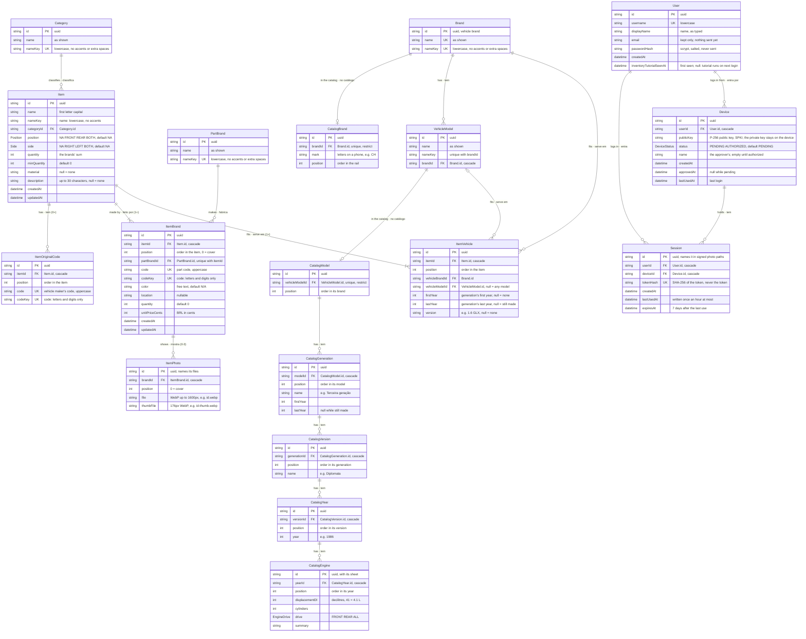

# Database · Banco de dados

[🇺🇸 English](#-english-us) · [🇧🇷 Português](#-português-brasil)

The inventory's PostgreSQL database, defined in [`apps/api/prisma/schema.prisma`](../apps/api/prisma/schema.prisma) and changed only through the migrations in [`apps/api/prisma/migrations`](../apps/api/prisma/migrations).

O banco PostgreSQL do estoque, definido em [`apps/api/prisma/schema.prisma`](../apps/api/prisma/schema.prisma) e alterado só pelas migrações em [`apps/api/prisma/migrations`](../apps/api/prisma/migrations).

## Diagram · Diagrama

---

## 🇺🇸 English (US)

### Entities

| Table | What it holds |
|---|---|
| `Item` | An inventory item: a part in stock, with what its brands share: its name, category, where on the vehicle it fits, the minimum stock, and how many there are, added up from its brands; and, when given, what the part is made of (`material`) and a short description of up to 30 characters, shown in its details and under its photo. |
| `ItemVehicle` | A vehicle an item's part fits, in order: a vehicle brand and, optionally, one of its models; without one, any model of the brand. It may also say its generation, by its first and last year (shown as "85/90", the last one empty while it is still made), and its version ("1.6 GLX"), neither of them part of the item's name. Every item fits at least one; an item from before vehicles became one of its vehicle, with the item's id. |
| `ItemBrand` | A brand that makes an item's part (Cobreq, Fras-le…), in order: its part code, color, location, quantity and unit price. Every item has at least one; an item from before brands became its first, with the item's id. |
| `ItemOriginalCode` | The vehicle maker's codes of an item's part (OEM), in order, the same for every brand that makes it. An item may have none. |
| `ItemPhoto` | Up to 3 photos of an item's brand, in order; the first one is the cover in the list. The files themselves are stored by the API under `PHOTOS_DIR`, each photo reduced to a WebP of up to 1600px next to its thumbnail. |
| `Category` | The categories an item is filed under (Motor, Freios…). |
| `PartBrand` | The brands of the parts (Bosch, NGK…). |
| `Brand` | The vehicle brands (Chevrolet, Volkswagen…), shared with the catalog. |
| `VehicleModel` | The models of each vehicle brand (Opala, Gol…). |
| `CatalogBrand` | A vehicle brand the Catalog tab has, with the letters on its line on a phone and its place in the rail. |
| `CatalogModel` | A vehicle model the Catalog tab has, of a catalog brand, in its brand's order. |
| `CatalogGeneration`, `CatalogVersion`, `CatalogYear` | The levels of a catalog model's tree, each in its order: a generation with its first and last year (the last empty while it is still made), its versions (Diplomata, GTS…) and their model years. |
| `CatalogEngine` | An engine of a catalog year, with its sheet: displacement in decilitres, cylinders, drive and summary. Its name in the tree ("4.1 L 6 cilindros") comes from the sheet, and its year and the sheet's title from the tree, so neither is kept twice. |
| `User` | Who logs in: their username, name, e-mail (kept only, nothing is sent to it yet), the hash of their password, and when they first saw the Inventory tutorial, which runs by itself only until then, on any device. It has no relation to the inventory tables. |
| `Device` | A device a user logs in from: its public key, unique per user, whether the server's computer authorized it, the name the approver gave it, and when it was recorded, authorized and last used. Nothing else about the device or its owner: no model, system, address or browser. |
| `Session` | A user logged in on one device, from a login or sign-up until "Sair" or 7 days without use: the device, the hash of the token the device sends, and when it was last used and expires. |

### Relationships

- Every item has **one** category, **one or more** vehicles, each of **one** vehicle brand and **at most one** of its models, a vehicle at most once in an item, and **one or more** brands, each of **one** part brand, a part brand at most once in an item. A vehicle without a model is **any model** of its brand; Universal (any vehicle) stands alone in an item's vehicles.
- A vehicle model belongs to **one** vehicle brand; a vehicle brand has **many** models.
- An item's brand has **0 to 3** photos (the limit is checked by the API).
- An item has **any number** of original codes, none at first.
- The catalog is a tree: a catalog brand is **one** vehicle brand and a catalog model **one** vehicle model of it, each in the catalog at most once; a model has **any number** of generations, a generation of versions, a version of years and a year of engines.
- A user logs in from **any number** of devices; every session belongs to **one** device and **one** user.
- The item, its vehicles and its brands store **references** (`categoryId`, `vehicleBrandId`, `partBrandId`, …), not names: renaming a list entry renames it on every item at once, and merging an entry into another moves its items there in one transaction (a vehicle brand moving its models along) before deleting it; an item that ends up with a vehicle twice keeps it once.

### Rules

| Rule | Where |
|---|---|
| Names are unique ignoring case, accents and extra spaces: `nameKey` holds the name in that form and is unique (a vehicle model's within its brand). | `Category`, `PartBrand`, `Brand`, `VehicleModel` |
| A part code is stored in uppercase and is unique as the search compares it, across every item's brands and original codes: `codeKey`, the code with letters and digits only, is unique too, so `CB4500` and `CB-4500` can't both be in stock. Each table keeps its own codes unique; the API keeps a brand's code and an original code apart, refusing one another item uses (409) or one the item holds twice (400). `codeKey` and `nameKey` let the search ignore separators and accents, and the search finds an item by any of its codes. | `ItemBrand.code`, `ItemOriginalCode.code`, `Item.nameKey` |
| The unit price is an integer in cents, so prices add up without rounding errors, from R$ 0,01 to R$ 1.000.000,00, which the API checks. | `ItemBrand.unitPriceCents` |
| `position` and `side` default to "not applicable", and so does a brand's `color`. The API speaks `N/A`, `D`, `T`, `Ambos` (position) and `N/A`, `LD`, `LE`, `Ambos` (side); the database keeps them as the `Position` and `Side` enums. | `Item`, `ItemBrand.color` |
| The quantities and the minimum are whole numbers from 0 to 1,000,000, which the API checks. The item's quantity is its brands' sum, kept by the API on every save. Stock status isn't stored: an item is out of stock at 0 and low at or under its minimum, counting all its brands. | `ItemBrand.quantity`, `Item.quantity`, `Item.minQuantity` |
| An item's brands keep their order in `position`; the API saves an edit's brands as the whole set: one sent with its id is kept, one without is new, and one left out is deleted with its photos. | `ItemBrand` |
| An item's original codes and its vehicles keep their order in `position`; an edit that sends them replaces the whole list. The filters by vehicle brand, model, generation and version match an item by any of its vehicles, and sorting by vehicle uses the first. The same model in two generations, or two versions, is two vehicles. | `ItemOriginalCode`, `ItemVehicle` |
| A list entry an item, a vehicle or a brand uses can't be deleted (`RESTRICT`), and two part brands both in one item can't be merged; deleting a vehicle brand deletes its models (`CASCADE`); deleting an item deletes its vehicles, brands and original codes, and a brand its photos (`CASCADE`). | Foreign keys, API |
| A vehicle brand or model the catalog has is deleted from the lists with its catalog rows, and merged into another with its place and tree (below); `RESTRICT` keeps a catalog row from being left without its entry, and the lists mark them `inCatalog`. Deleting a level of the catalog deletes the levels under it (`CASCADE`). | `CatalogBrand`, `CatalogModel`, API |
| A username is kept in lowercase and is unique, so names that differ only in case are the same user. It takes 3 to 32 lowercase letters, digits, dots or hyphens. | `User.username`, API |
| A password is never kept as typed: `passwordHash` holds `scrypt$<salt>$<hash>` with a random salt per user, and the API never sends it. | `User.passwordHash` |
| A token is never kept: `tokenHash` holds its SHA-256, so the table alone can't be used to log in. An expired session is deleted when it is next looked up; deleting a user deletes their sessions (`CASCADE`). | `Session` |
| Only public keys are kept: the private key never leaves its device, so the table holds nothing secret. A key is recorded `PENDING` on its first login with the right password, or `AUTHORIZED` at once from the server's computer; removing a device deletes its sessions (`CASCADE`), and so does deleting its user. | `Device` |

### Migrations

- **Two schemas, the same models.** The database runs on PostgreSQL (`prisma/schema.prisma`, `prisma/migrations`) or SQLite (`prisma/sqlite/schema.prisma`, `prisma/sqlite/migrations`). A change to the database goes in both schemas, each with its own migration, in the same pull request; `pnpm --filter @apc/api lint` fails when their models differ (`db:check-schemas`).
- **The API's own migration runner.** `src/db/migrate.ts` applies each pending migration's `migration.sql` whole, in one transaction, through the database's own driver (pg, better-sqlite3), and records it in `_prisma_migrations` as `prisma migrate deploy` does: a random id, the SHA-256 of the file and when it started and finished. A database migrated either way is the same to the other; `prisma migrate status` agrees. A migration that fails, or one recorded as started and never finished, stops the run. The server the desktop app ships runs it on start (`APC_MIGRATE_ON_START=1`), so it needs no Prisma CLI.
- **The same commands on both.** `pnpm --filter @apc/api db:migrate` applies the pending migrations of the database `DATABASE_URL` names, with that runner, and `db:check` fails when that database doesn't match its schema. To write a new migration, run `prisma migrate dev --name <change>` once with a PostgreSQL `DATABASE_URL`, and once with `--config prisma.sqlite.config.ts` and a SQLite one.
- **An empty database migrates in one go.** `db:migrate` applies every pending migration in one database session. A new computer (see [home-server.md](home-server.md)) gets them all at once, while the computer at home took them one at a time. CI's `migrations` job builds an empty PostgreSQL and an empty SQLite file from them, checks each matches its schema, seeds it and runs the API's tests that need a database.
- **Helpers in `pg_temp` live for the session.** A migration that creates a function in `pg_temp`, such as the name-key helper `list_key`, drops it at its end, so the next one can create it again. `20261008120000_drop_list_key` drops the helper that `20261008000000_item_lists` left behind, without changing a migration already applied.
- **The starting catalog comes in a migration.** `20261106000000_catalog` creates the catalog's tables and inserts the catalog a new database starts with, the same rows as `TEST_CATALOG_DATA` in `@apc/domain/test-catalog`, ids included: each of its vehicle brands and models joins the lists unless they hold its name already, so a database in use keeps its own ids for them, and the desktop app's database, which is never seeded, has the catalog too.
- **The starting vehicle lists come in a migration.** `20261112000000_vehicle_lists` gives every server, new or updated, the vehicle brands most sold in Brazil and their usual models, old and new, the same as `STARTING_VEHICLE_BRANDS` in `@apc/domain/vehicle-lists`. A brand typed under another name (`VEHICLE_BRAND_ALIASES`: GM, VW, M.Benz…) is first renamed to its standard name, or merged into it when both are held, the way the lists' merge does it: its models and its items' vehicles move over, and an item left with the same vehicle twice keeps it once; a catalog brand is never merged away. Then each listed brand and model is added unless its list holds its name already, so the user's own entries and spellings stay, and no item is deleted. The migration's SQL is written from that list and is the same on both databases. Where the names come from is in [licenses.md](licenses.md#vehicle-data).
- **The starting brands and models join the Catalog in a migration.** `20261113000000_catalog_starting_brands` makes each brand of `STARTING_VEHICLE_BRANDS` a catalog brand and each of its listed models a catalog model, with empty trees: a brand the Catalog has keeps its place and its tree, the others go at the end of the rail in the list's order with their letters, and a brand's models after the ones it has. Only the brands and models the lists hold join, so nothing is added to or renamed in the lists, and it runs once: a brand deleted from the Catalog later doesn't come back. Deleting a catalog brand (`DELETE /catalog/brands/:id`) deletes its models' trees and keeps its vehicle brand and models in the lists; deleting a vehicle brand or model of the catalog from the lists takes its catalog rows with it, in one transaction, and is refused while an item uses it.
- **Merging catalog entries joins their trees.** Merging a vehicle model of the catalog into another (`POST /vehicle-models/:id/merge`) moves its catalog model to the kept model when that one has none, or joins the two trees: a generation joins the one of the same name and years, a version the one of the same name, a year the one of the same number, and the rest, engines included, goes after the kept model's own (`joinCatalogTrees` in `@apc/domain/catalog`). Merging a vehicle brand of the catalog gives its place in the rail to the kept brand when the Catalog doesn't have it; when it has both, the merged brand's models go after the kept brand's own, a model of the same name joining its tree, and the merged brand leaves the rail. The items move as in any merge, all in one transaction, and the confirmation says what goes along (`catalogMergeNote`).
- **An applied migration never changes.** A fix goes into a new migration. Even one dated between older ones is applied on a database that has the later ones, as long as it is harmless there.
- **A copy before migrating.** The server the desktop app ships copies its SQLite file before applying pending migrations (`src/db/backup.ts`): WAL checkpointed, the file copied to `backups/apc-before-<version>-<date>.db` beside it, with the same key, out of WAL mode and checked with `quick_check`, keeping the last 3. A migration that fails rolls back on its own; the copy is for one that succeeds and harms the data. A copy that can't be made stops the server before migrating. PostgreSQL isn't copied: the log asks for a `pg_dump`.

### SQLite

The same database also runs on SQLite, chosen by `DATABASE_URL`: `file:./data/apc.db` opens a file, read from `apps/api`, and `postgresql://…` PostgreSQL. One server uses one of them; the data is never written to both.

| | SQLite | PostgreSQL |
|---|---|---|
| Pick it for | One computer at home serving the phone and the desktop app | A database already in use, or more than one computer on the same database |
| To install | Nothing: the file is created by `db:migrate` | PostgreSQL, a password and a Windows service |
| Who reaches the data | Only this computer, through the file | Any program with its address and password; only this computer when set up so ([#215](https://github.com/ChrisCamilo/apc-universal-repair/issues/215)) |
| Backup | Copy `apps/api/data` with the server off | `pg_dump` and `pg_restore` |
| Writes at once | One at a time, which a workshop doesn't notice | Many |

[#221](https://github.com/ChrisCamilo/apc-universal-repair/issues/221) proved it, with the findings below.

- **The schema:** `prisma/sqlite/schema.prisma` is `prisma/schema.prisma` with only the provider and the client's folder changed. Its own migrations are in `prisma/sqlite/migrations`, and `prisma.sqlite.config.ts` points the Prisma CLI at them (`--config prisma.sqlite.config.ts`). `pnpm --filter @apc/api db:generate` builds both clients. The enums are kept as text and the dates as ISO text; the rules above hold the same.
- **The adapter:** `@prisma/adapter-better-sqlite3`, whose native module installs prebuilt on Windows and Linux. It keeps one connection and waits up to 5 s for a write lock held by another process. libSQL was tried too and failed with "Operation has timed out" as soon as two processes used the file, on an older SQLite (3.45 against 3.53).
- **What was checked:** every API test runs on both databases, including `test:db`, in CI's `migrations` job, once per database. That covers interactive transactions (saving an item, the import), `createMany` (photos), the low-stock filter comparing two columns, the search on `nameKey` and `codeKey`, sorting, the unique keys, `CASCADE` and `RESTRICT`, and 20 edits and 10 logins at once.
- **WAL:** the API turns on `PRAGMA journal_mode = WAL` when it starts (`prepareDatabase`), so the list is read while an item is saved; it stays on in the file, next to its `-wal` and `-shm` files.
- **One process writes:** the API is the only one, so its requests take turns on its connection. A second process writing at the same time, such as a script, can hit Prisma's 5 s transaction timeout, so scripts run with the server off and the tests on SQLite run one file at a time.
- **Moving between them:** `pnpm --filter @apc/api db:copy --from <url> --to <url>` copies every table but the sessions, in one transaction on the target, into an empty database made with `db:migrate` (`src/db/copy.ts`), where the starting catalog its migration inserted doesn't count as data and gives way to the source's catalog and lists; the desktop app imports an old server with the same copy (see [home-server.md](home-server.md#7-importing-an-old-server)). It refuses a target that isn't empty, either database lacking a migration, and a server that answers.
- **Encrypted at rest:** the desktop app's SQLite file is encrypted (`src/db/cipher.ts`), so a copy of it is unreadable without its key.
  - **The cipher:** better-sqlite3 is installed as `better-sqlite3-multiple-ciphers` (SQLite3 Multiple Ciphers), through an override in `pnpm-workspace.yaml`, so the API, the migration runner and Prisma's adapter all use it. The file is in SQLCipher 4's format, so its key also opens it in tools that read SQLCipher, such as DB Browser for SQLite.
  - **Which file has a key:** the server's own, the one `DATABASE_URL` names, takes `APC_SQLITE_KEY`; any other file is plain unless a database task gives its key, as an import of an encrypted file does. Every connection sends the key first. Without `APC_SQLITE_KEY`, as in development, the file is plain.
  - **The key:** 32 random bytes the desktop app makes the first time it runs the server on SQLite, kept in `config.json` only sealed by Windows DPAPI (Electron's `safeStorage`), and handed to the server in `APC_SQLITE_KEY`. Its recovery copy shows in the app until the user says it is kept; without it, a copy of the file opens on no other computer or Windows user.
  - **A plain file from before:** the server encrypts it in place on its first start with a key (`PRAGMA rekey`, after switching WAL off), through a backup copy that is removed once the encrypted file reads back. A key that doesn't open the file stops the server, saying so.
  - **Migrations and checks:** `prisma migrate deploy` can't open an encrypted file, which is why the API has its own runner. `db:check` checks an encrypted file has every migration applied, and diffs a plain copy built from the same migrations against the schema. CI's `sqlite` job runs every database test on an encrypted file.

### Starting data

`pnpm --filter @apc/api db:seed` fills a new database with the test users (`christian.camilo` and `oficina`, from `@apc/domain/test-users`, with their passwords hashed), the default categories, part brands, vehicle brands with their models and a few sample items, three of them made by several brands (front brake pads, front shock absorber and air filter), with their original codes, and two that fit two vehicles. It can run again without duplicating anything. The catalog isn't seeded: its migration brings it.

---

## 🇧🇷 Português (Brasil)

### Entidades

| Tabela | O que guarda |
|---|---|
| `Item` | Um item do estoque: uma peça, com o que as marcas dela têm em comum: o nome, a categoria, onde serve no veículo, o estoque mínimo, e quantas há, somando as marcas; e, quando informados, de que a peça é feita (`material`) e uma descrição curta de até 30 caracteres, exibida nos detalhes e embaixo da foto. |
| `ItemVehicle` | Um veículo em que a peça do item serve, em ordem: uma marca de veículo e, se quiser, um dos modelos dela; sem modelo, qualquer modelo da marca. Ele também pode dizer a geração, pelo primeiro e pelo último ano (exibida como "85/90", o último vazio enquanto ainda é fabricado), e a versão ("1.6 GLX"), nenhuma das duas no nome do item. Todo item serve em pelo menos um; um item de antes dos veículos virou um item do seu veículo, com o id do item. |
| `ItemBrand` | Uma marca que fabrica a peça do item (Cobreq, Fras-le…), em ordem: o código da peça, a cor, o local, a quantidade e o valor unitário. Todo item tem pelo menos uma; um item de antes das marcas virou a primeira, com o id do item. |
| `ItemOriginalCode` | Os códigos da montadora para a peça do item (OEM), em ordem, os mesmos para todas as marcas que a fabricam. Um item pode não ter nenhum. |
| `ItemPhoto` | Até 3 fotos de uma marca do item, em ordem; a primeira é a capa na lista. Os arquivos ficam guardados pela API em `PHOTOS_DIR`, cada foto reduzida a um WebP de até 1600px ao lado da miniatura. |
| `Category` | As categorias dos itens (Motor, Freios…). |
| `PartBrand` | As marcas das peças (Bosch, NGK…). |
| `Brand` | As marcas de veículo (Chevrolet, Volkswagen…), as mesmas do catálogo. |
| `VehicleModel` | Os modelos de cada marca de veículo (Opala, Gol…). |
| `CatalogBrand` | Uma marca de veículo que a aba Catálogo tem, com as letras da linha dela no celular e o lugar dela na coluna de marcas. |
| `CatalogModel` | Um modelo de veículo que a aba Catálogo tem, de uma marca do catálogo, na ordem da marca. |
| `CatalogGeneration`, `CatalogVersion`, `CatalogYear` | Os níveis da árvore de um modelo do catálogo, cada um na sua ordem: uma geração com o primeiro e o último ano (o último vazio enquanto ainda é fabricada), as versões dela (Diplomata, GTS…) e os anos-modelo delas. |
| `CatalogEngine` | Um motor de um ano do catálogo, com a ficha: cilindrada em decilitros, cilindros, tração e resumo. O nome dele na árvore ("4.1 L 6 cilindros") vem da ficha, e o ano e o título da ficha vêm da árvore, então nada é guardado duas vezes. |
| `User` | Quem entra no app: o usuário, o nome, o e-mail (só guardado, nada é enviado a ele ainda), o hash da senha e quando viu o tutorial do Estoque pela primeira vez, que só roda sozinho até então, em qualquer aparelho. Não se relaciona com as tabelas do estoque. |
| `Device` | Um dispositivo pelo qual um usuário entra: a chave pública dele, única por usuário, se o computador do servidor o autorizou, o nome que quem autorizou deu, e quando foi registrado, autorizado e usado pela última vez. Nada mais sobre o dispositivo ou o dono: nem modelo, sistema, endereço ou navegador. |
| `Session` | Um usuário logado num aparelho, de um login ou cadastro até o "Sair" ou 7 dias sem uso: o dispositivo, o hash do token que o aparelho envia, e quando foi usada pela última vez e quando expira. |

### Relacionamentos

- Todo item tem **uma** categoria, **um ou mais** veículos, cada um de **uma** marca de veículo e **no máximo um** modelo dela, um veículo no máximo uma vez num item, e **uma ou mais** marcas, cada uma de **uma** marca de peça, uma marca de peça no máximo uma vez num item. Um veículo sem modelo é **qualquer modelo** da marca; Universal (qualquer veículo) fica sozinho nos veículos de um item.
- Um modelo pertence a **uma** marca de veículo; uma marca tem **vários** modelos.
- Uma marca do item tem de **0 a 3** fotos (o limite é conferido pela API).
- Um item tem **quantos** códigos originais precisar, nenhum no começo.
- O catálogo é uma árvore: uma marca do catálogo é **uma** marca de veículo e um modelo do catálogo **um** modelo de veículo dela, cada um no máximo uma vez no catálogo; um modelo tem **quantas** gerações precisar, uma geração versões, uma versão anos e um ano motores.
- Um usuário entra por **quantos** dispositivos precisar; toda sessão é de **um** dispositivo e de **um** usuário.
- O item, os veículos e as marcas dele guardam **referências** (`categoryId`, `vehicleBrandId`, `partBrandId`, …), não nomes: renomear uma entrada de lista renomeia em todos os itens de uma vez, e juntar uma entrada a outra passa os itens dela para a outra numa só transação (uma marca de veículo levando os modelos junto) antes de excluí-la; um item que fica com um veículo duas vezes o mantém uma vez.

### Regras

| Regra | Onde |
|---|---|
| Os nomes são únicos ignorando maiúsculas, acentos e espaços a mais: `nameKey` guarda o nome nessa forma e é único (o de um modelo, dentro da marca). | `Category`, `PartBrand`, `Brand`, `VehicleModel` |
| O código da peça é guardado em maiúsculas e é único do jeito que a busca compara, entre as marcas e os códigos originais de todos os itens: `codeKey`, o código só com letras e números, também é único, então `CB4500` e `CB-4500` não podem estar os dois no estoque. Cada tabela mantém os próprios códigos únicos; a API separa o código de uma marca de um código original, recusando um que outro item usa (409) ou um que o item teria duas vezes (400). `codeKey` e `nameKey` deixam a busca ignorar separadores e acentos, e a busca acha um item por qualquer um dos seus códigos. | `ItemBrand.code`, `ItemOriginalCode.code`, `Item.nameKey` |
| O valor unitário é um inteiro em centavos, para os valores somarem sem erro de arredondamento, de R$ 0,01 a R$ 1.000.000,00, que a API confere. | `ItemBrand.unitPriceCents` |
| `position` e `side` começam como "não se aplica", e a `color` de uma marca também. A API usa `N/A`, `D`, `T`, `Ambos` (posição) e `N/A`, `LD`, `LE`, `Ambos` (lado); o banco guarda nos enums `Position` e `Side`. | `Item`, `ItemBrand.color` |
| As quantidades e o mínimo são números inteiros de 0 a 1.000.000, que a API confere. A quantidade do item é a soma das marcas, mantida pela API a cada gravação. A situação do estoque não é guardada: o item está esgotado em 0 e baixo quando está no mínimo ou abaixo, somando todas as marcas. | `ItemBrand.quantity`, `Item.quantity`, `Item.minQuantity` |
| As marcas de um item mantêm a ordem em `position`; a API grava as marcas de uma edição como o conjunto inteiro: uma enviada com o id é mantida, uma sem id é nova, e uma que ficou de fora é excluída com as fotos. | `ItemBrand` |
| Os códigos originais e os veículos de um item mantêm a ordem em `position`; uma edição que os envia troca a lista inteira. Os filtros por marca, modelo, geração e versão do veículo acham um item por qualquer um dos veículos dele, e ordenar por veículo usa o primeiro. O mesmo modelo em duas gerações, ou em duas versões, são dois veículos. | `ItemOriginalCode`, `ItemVehicle` |
| Uma entrada de lista usada por um item, um veículo ou uma marca não pode ser excluída (`RESTRICT`), e duas marcas de peça que estão no mesmo item não podem ser juntadas; excluir uma marca de veículo exclui os modelos dela (`CASCADE`); excluir um item exclui os veículos, as marcas e os códigos originais dele, e uma marca as fotos dela (`CASCADE`). | Chaves estrangeiras, API |
| Uma marca ou um modelo de veículo que o catálogo tem é excluído das listas com as linhas dele no catálogo, e juntado a outro levando o lugar e a árvore (abaixo); o `RESTRICT` não deixa uma linha do catálogo sem a entrada dela, e as listas os marcam com `inCatalog`. Excluir um nível do catálogo exclui os níveis abaixo dele (`CASCADE`). | `CatalogBrand`, `CatalogModel`, API |
| O usuário é guardado em minúsculas e é único, então nomes que só mudam em maiúsculas são o mesmo usuário. Ele aceita de 3 a 32 letras minúsculas, números, pontos ou hífens. | `User.username`, API |
| A senha nunca é guardada como foi digitada: `passwordHash` guarda `scrypt$<sal>$<hash>` com um sal aleatório por usuário, e a API nunca o envia. | `User.passwordHash` |
| O token nunca é guardado: `tokenHash` guarda o SHA-256 dele, então a tabela sozinha não serve para entrar. Uma sessão expirada é apagada na próxima vez que é procurada; apagar um usuário apaga as sessões dele (`CASCADE`). | `Session` |
| Só chaves públicas são guardadas: a chave privada nunca sai do dispositivo, então a tabela não guarda nada secreto. Uma chave é registrada `PENDING` no primeiro login com a senha certa, ou `AUTHORIZED` na hora pelo computador do servidor; remover um dispositivo apaga as sessões dele (`CASCADE`), e apagar o usuário também. | `Device` |

### Migrações

- **Dois schemas, os mesmos modelos.** O banco roda em PostgreSQL (`prisma/schema.prisma`, `prisma/migrations`) ou SQLite (`prisma/sqlite/schema.prisma`, `prisma/sqlite/migrations`). Uma mudança no banco vai nos dois schemas, cada um com a sua migração, no mesmo pull request; o `pnpm --filter @apc/api lint` falha quando os modelos deles diferem (`db:check-schemas`).
- **O executor de migrações da API.** O `src/db/migrate.ts` aplica o `migration.sql` inteiro de cada migração pendente, numa transação, pelo driver do próprio banco (pg, better-sqlite3), e a registra em `_prisma_migrations` como o `prisma migrate deploy` faz: um id aleatório, o SHA-256 do arquivo e quando começou e terminou. Um banco migrado por um é igual para o outro; o `prisma migrate status` concorda. Uma migração que falha, ou uma registrada como começada e nunca terminada, para a execução. O servidor que o app desktop traz o roda ao ligar (`APC_MIGRATE_ON_START=1`), então não precisa do Prisma CLI.
- **Os mesmos comandos nos dois.** O `pnpm --filter @apc/api db:migrate` aplica as migrações pendentes do banco que o `DATABASE_URL` indica, com esse executor, e o `db:check` falha quando esse banco não bate com o schema dele. Para escrever uma migração nova, rode `prisma migrate dev --name <mudança>` uma vez com um `DATABASE_URL` do PostgreSQL, e uma vez com `--config prisma.sqlite.config.ts` e um do SQLite.
- **Um banco vazio migra de uma vez.** O `db:migrate` aplica todas as migrações pendentes numa única sessão do banco. Um computador novo (veja [home-server.md](home-server.md#-português-brasil)) recebe todas de uma vez, enquanto o computador de casa as recebeu uma a uma. O job `migrations` do CI monta um PostgreSQL vazio e um arquivo SQLite vazio a partir delas, confere que cada um bate com o seu schema, roda o seed e os testes da API que precisam de um banco.
- **Funções auxiliares em `pg_temp` duram a sessão.** Uma migração que cria uma função em `pg_temp`, como a `list_key` da chave dos nomes, a remove no fim, para a próxima poder criá-la de novo. A `20261008120000_drop_list_key` remove a função que a `20261008000000_item_lists` deixou, sem mudar uma migração já aplicada.
- **O catálogo inicial vem numa migração.** A `20261106000000_catalog` cria as tabelas do catálogo e insere o catálogo com que um banco novo começa, as mesmas linhas do `TEST_CATALOG_DATA` do `@apc/domain/test-catalog`, ids inclusive: cada marca e modelo de veículo dele entra nas listas, a não ser que elas já tenham o nome, então um banco em uso mantém os próprios ids deles, e o banco do app desktop, que nunca recebe o seed, também tem o catálogo.
- **As listas de veículos iniciais vêm numa migração.** A `20261112000000_vehicle_lists` dá a todo servidor, novo ou atualizado, as marcas de veículo mais vendidas no Brasil e os modelos de costume delas, antigos e novos, as mesmas do `STARTING_VEHICLE_BRANDS` do `@apc/domain/vehicle-lists`. Uma marca digitada com outro nome (`VEHICLE_BRAND_ALIASES`: GM, VW, M.Benz…) primeiro ganha o nome padrão, ou é unida a ele quando os dois existem, do jeito que a união das listas faz: os modelos dela e os veículos dos itens dela passam para a outra, e um item que fica com o mesmo veículo duas vezes o mantém uma vez; uma marca do catálogo nunca é unida a outra. Depois cada marca e modelo da lista entra, a não ser que a lista já tenha o nome, então as entradas e grafias do usuário ficam, e nenhum item é apagado. O SQL da migração é escrito a partir dessa lista e é o mesmo nos dois bancos. De onde vêm os nomes está no [licenses.md](licenses.md#dados-de-veículos).
- **As marcas e modelos iniciais entram no Catálogo numa migração.** A `20261113000000_catalog_starting_brands` faz de cada marca do `STARTING_VEHICLE_BRANDS` uma marca do catálogo e de cada modelo da lista dela um modelo do catálogo, com as árvores vazias: uma marca que o Catálogo já tem mantém o lugar e a árvore, as outras vão para o fim da barra na ordem da lista com as letras delas, e os modelos de uma marca depois dos que ela tem. Só entram as marcas e modelos que as listas têm, então nada é adicionado nem renomeado nas listas, e ela roda uma vez: uma marca excluída do Catálogo depois não volta. Excluir uma marca do catálogo (`DELETE /catalog/brands/:id`) apaga as árvores dos modelos dela e mantém a marca e os modelos de veículo nas listas; excluir das listas uma marca ou modelo de veículo do catálogo leva junto as linhas dele no catálogo, numa transação, e é recusado enquanto um item o usa.
- **Juntar entradas do catálogo junta as árvores.** Juntar um modelo de veículo do catálogo a outro (`POST /vehicle-models/:id/merge`) passa o modelo do catálogo dele para o modelo mantido quando este não tem um, ou junta as duas árvores: uma geração se junta à de mesmo nome e anos, uma versão à de mesmo nome, um ano ao de mesmo número, e o resto, motores incluídos, vai depois dos do modelo mantido (`joinCatalogTrees` do `@apc/domain/catalog`). Juntar uma marca de veículo do catálogo dá o lugar dela na barra à marca mantida quando o Catálogo não a tem; quando tem as duas, os modelos da marca juntada vão depois dos da mantida, um modelo de mesmo nome juntando a árvore, e a marca juntada sai da barra. Os itens passam como em toda junção, tudo numa transação, e a confirmação diz o que vai junto (`catalogMergeNote`).
- **Uma migração aplicada nunca muda.** Uma correção vai numa migração nova. Mesmo uma com data entre as antigas é aplicada num banco que já tem as seguintes, desde que não faça mal ali.
- **Uma cópia antes de migrar.** O servidor que o app desktop traz copia o arquivo SQLite antes de aplicar as migrações pendentes (`src/db/backup.ts`): o WAL juntado ao arquivo, o arquivo copiado para `backups/apc-before-<versão>-<data>.db` ao lado dele, com a mesma chave, fora do modo WAL e conferido com o `quick_check`, mantendo as 3 últimas. Uma migração que falha se desfaz sozinha; a cópia é para uma que dá certo e estraga os dados. Uma cópia que não pode ser feita para o servidor antes de migrar. O PostgreSQL não é copiado: o log pede um `pg_dump`.

### SQLite

O mesmo banco também roda em SQLite, escolhido pelo `DATABASE_URL`: `file:./data/apc.db` abre um arquivo, lido a partir de `apps/api`, e `postgresql://…` o PostgreSQL. Um servidor usa um deles; os dados nunca são gravados nos dois.

| | SQLite | PostgreSQL |
|---|---|---|
| Escolha para | Um computador em casa servindo o celular e o app desktop | Um banco já em uso, ou mais de um computador no mesmo banco |
| Para instalar | Nada: o arquivo é criado pelo `db:migrate` | O PostgreSQL, uma senha e um serviço do Windows |
| Quem chega aos dados | Só este computador, pelo arquivo | Qualquer programa com o endereço e a senha dele; só este computador quando configurado assim ([#215](https://github.com/ChrisCamilo/apc-universal-repair/issues/215)) |
| Backup | Copiar `apps/api/data` com o servidor desligado | `pg_dump` e `pg_restore` |
| Gravações ao mesmo tempo | Uma por vez, o que uma oficina não percebe | Muitas |

A [#221](https://github.com/ChrisCamilo/apc-universal-repair/issues/221) provou isso, com as conclusões abaixo.

- **O schema:** `prisma/sqlite/schema.prisma` é o `prisma/schema.prisma` com só o provider e a pasta do cliente trocados. As migrações dele ficam em `prisma/sqlite/migrations`, e o `prisma.sqlite.config.ts` aponta o Prisma CLI para elas (`--config prisma.sqlite.config.ts`). O `pnpm --filter @apc/api db:generate` gera os dois clientes. Os enums ficam como texto e as datas como texto ISO; as regras acima valem igual.
- **O adaptador:** `@prisma/adapter-better-sqlite3`, cujo módulo nativo instala pré-compilado no Windows e no Linux. Ele mantém uma conexão e espera até 5 s por uma trava de escrita de outro processo. O libSQL também foi testado e falhou com "Operation has timed out" assim que dois processos usaram o arquivo, num SQLite mais antigo (3.45 contra 3.53).
- **O que foi conferido:** todos os testes da API rodam nos dois bancos, inclusive o `test:db`, no job `migrations` do CI, uma vez para cada banco. Isso cobre transações interativas (salvar um item, a importação), `createMany` (fotos), o filtro de estoque baixo comparando duas colunas, a busca em `nameKey` e `codeKey`, a ordenação, as chaves únicas, `CASCADE` e `RESTRICT`, e 20 edições e 10 logins ao mesmo tempo.
- **WAL:** a API liga o `PRAGMA journal_mode = WAL` ao iniciar (`prepareDatabase`), para a lista ser lida enquanto um item é salvo; ele fica ligado no arquivo, ao lado dos arquivos `-wal` e `-shm`.
- **Um processo escreve:** a API é o único, então as requisições dela se revezam na conexão. Um segundo processo escrevendo ao mesmo tempo, como um script, pode estourar o tempo de 5 s das transações do Prisma, por isso os scripts rodam com o servidor desligado e os testes em SQLite rodam um arquivo por vez.
- **Passar de um para o outro:** o `pnpm --filter @apc/api db:copy --from <url> --to <url>` copia todas as tabelas menos as sessões, numa transação no destino, para um banco vazio feito com o `db:migrate` (`src/db/copy.ts`), onde o catálogo inicial que a migração dele inseriu não conta como dado e dá lugar ao catálogo e às listas da origem; o app desktop importa um servidor antigo com a mesma cópia (veja [home-server.md](home-server.md#7-importar-um-servidor-antigo)). Ele recusa um destino que não está vazio, um dos bancos sem alguma migração e um servidor que responde.
- **Criptografado em repouso:** o arquivo SQLite do app desktop é criptografado (`src/db/cipher.ts`), então uma cópia dele não é legível sem a chave.
  - **A cifra:** o better-sqlite3 é instalado como `better-sqlite3-multiple-ciphers` (SQLite3 Multiple Ciphers), por um override no `pnpm-workspace.yaml`, então a API, o executor de migrações e o adapter do Prisma usam todos ele. O arquivo fica no formato do SQLCipher 4, então a chave dele também o abre em ferramentas que leem SQLCipher, como o DB Browser for SQLite.
  - **Que arquivo tem chave:** o do próprio servidor, o que o `DATABASE_URL` indica, usa o `APC_SQLITE_KEY`; qualquer outro arquivo é comum, a não ser que uma tarefa de banco passe a chave dele, como faz a importação de um arquivo criptografado. Toda conexão manda a chave primeiro. Sem o `APC_SQLITE_KEY`, como em desenvolvimento, o arquivo é comum.
  - **A chave:** 32 bytes aleatórios que o app desktop cria na primeira vez que roda o servidor no SQLite, guardados no `config.json` só lacrados pelo DPAPI do Windows (o `safeStorage` do Electron), e passados ao servidor no `APC_SQLITE_KEY`. A cópia de recuperação dela aparece no app até o usuário dizer que a guardou; sem ela, uma cópia do arquivo não abre em nenhum outro computador nem usuário do Windows.
  - **Um arquivo comum de antes:** o servidor o criptografa no lugar na primeira vez que liga com uma chave (`PRAGMA rekey`, depois de desligar o WAL), por uma cópia de segurança que é apagada quando o arquivo criptografado é lido de volta. Uma chave que não abre o arquivo para o servidor, dizendo isso.
  - **Migrações e conferências:** o `prisma migrate deploy` não abre um arquivo criptografado, e é por isso que a API tem o executor próprio. O `db:check` confere que um arquivo criptografado tem todas as migrações aplicadas, e compara com o schema uma cópia comum feita das mesmas migrações. O job `sqlite` do CI roda todos os testes de banco num arquivo criptografado.

### Dados iniciais

`pnpm --filter @apc/api db:seed` preenche um banco novo com os usuários de teste (`christian.camilo` e `oficina`, de `@apc/domain/test-users`, com as senhas em hash), as categorias, marcas de peça, marcas de veículo com seus modelos e alguns itens de exemplo, três deles de várias marcas (pastilha de freio dianteira, amortecedor dianteiro e filtro de ar), com os códigos originais, e dois que servem em dois veículos. Pode rodar de novo sem duplicar nada. O catálogo não vem do seed: a migração dele o traz.
