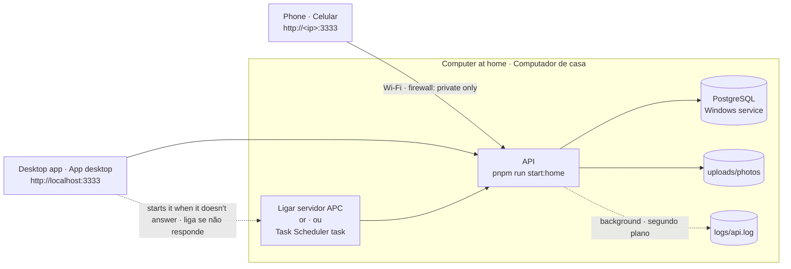

# Running at home · Rodando em casa

[🇺🇸 English](#-english-us) · [🇧🇷 Português](#-português-brasil)

How to run the API and the database on a Windows computer at home, so the phone app on the same Wi-Fi, and the desktop app on that computer, use it. Written for whoever looks after that computer, not only for developers.

Como rodar a API e o banco num computador Windows em casa, para o app do celular na mesma rede Wi-Fi, e o app desktop nesse computador, usarem ele. Escrito para quem cuida desse computador, não só para quem programa.



---

## 🇺🇸 English (US)

> **Home network only.** The API asks for a login on every call, but has no HTTPS yet ([#216](https://github.com/ChrisCamilo/apc-universal-repair/issues/216)), so passwords and tokens cross the Wi-Fi in clear text. Never open port 3333 on the router or expose the computer to the internet.

### 1. What to install (once, as administrator)

1. **Node.js** 22.11 or newer (the LTS installer from nodejs.org). Then, in a PowerShell opened as administrator, turn on pnpm:
   ```powershell
   corepack enable
   ```
2. **Git**, to download and update the project.
3. **PostgreSQL**. The installer asks for a password for the `postgres` user: write it down. It also installs PostgreSQL as a Windows service that starts with the computer. To check it, open `services.msc` and look for `postgresql-x64-<version>`: its status should be *Running* and its startup type *Automatic*.
4. Create the database. In the Start menu, open *SQL Shell (psql)*, press Enter until it asks for the password, type it, and run:
   ```sql
   CREATE DATABASE apc_universal_repair;
   ```

### 2. Get the project ready (once)

In a normal PowerShell, in the folder where the project should live. `git checkout` puts it on the latest [release](https://github.com/ChrisCamilo/apc-universal-repair/releases), the version of the desktop app, here `v0.2.0`:

```powershell
git clone https://github.com/ChrisCamilo/apc-universal-repair.git
cd apc-universal-repair
git checkout v0.2.0
pnpm install
copy apps\api\.env.example apps\api\.env
notepad apps\api\.env
```

In `apps\api\.env`, change `DATABASE_URL` to the `postgres` user and its password:

```
DATABASE_URL="postgresql://postgres:<password>@localhost:5432/apc_universal_repair"
```

`PORT` is the port the phone uses (3333 is fine). `PHOTOS_DIR` is where the photos are saved, `apps\api\uploads\photos` by default. The `.env` file is never committed.

Then create the tables and add the starting data (the test users, the default lists and a few sample items, which can be deleted in the app):

```powershell
pnpm --filter @apc/api exec prisma migrate deploy
pnpm --filter @apc/api db:seed
```

### 3. Turn the server on

There are two ways, and both can be set up at the same time. Each starts `pnpm run start:home` in `apps/api`, which applies any new migrations and then starts the API. Commands below run from the project folder.

**By hand: "Ligar servidor APC"** (normal user)

```powershell
powershell -ExecutionPolicy Bypass -File apps\api\scripts\install-shortcut.ps1
```

This creates the **Ligar servidor APC** shortcut on the desktop. Double-click it to open a window with the server's log. **To turn the server off, close that window.** If the server is already on (for example, through the automatic task), the shortcut says so and doesn't start a second copy.

**Automatic: a Task Scheduler task**

```powershell
powershell -ExecutionPolicy Bypass -File apps\api\scripts\install-task.ps1
```

- As a **normal user**, the task "APC Universal Repair API" starts the server, with no window, whenever this user signs in to Windows.
- To start it **with Windows, before anyone signs in**, run the same command with `-AtStartup` in a PowerShell opened as administrator. Windows only lets an administrator create that kind of task.
- The script starts the task right away. The server's log is in `apps\api\logs\api.log`. Once it passes 10 MB, it is moved to `api.old.log`.
- If the API stops (for example, because PostgreSQL wasn't up yet at startup), it starts again after 10 seconds.
- To turn it off without removing the task, run `powershell -ExecutionPolicy Bypass -File apps\api\scripts\stop-server.ps1` (normal user). It turns off the server started by the task or by the shortcut. Stopping the task in the Task Scheduler isn't enough: Windows ends only the task's first process, and the API keeps running.
- To turn it on again: `Start-ScheduledTask "APC Universal Repair API"`, or the next time this user signs in.
- To remove it: `powershell -ExecutionPolicy Bypass -File apps\api\scripts\uninstall-task.ps1`, which also turns the server off. A task made with `-AtStartup` must be removed as administrator.

**The desktop app also turns it on.** When the APC Universal Repair desktop app opens and the server doesn't answer, it starts the server in the background the same way as the task (no window, same log), and shows "Ligando o servidor" until it answers. The server keeps running after the app closes, so the phone keeps working; `stop-server.ps1` turns it off. If the server is already on, the app leaves it alone.

### 4. Which steps need an administrator

| Step | Administrator? |
|---|---|
| Installing Node.js, Git and PostgreSQL, and `corepack enable` | Yes, once |
| Firewall rule for port 3333 | Yes, once |
| `pnpm install`, `.env`, migrations and seed | No |
| Desktop shortcut, turning the server on by hand and `stop-server.ps1` | No |
| Automatic task that starts when the user signs in | No |
| Automatic task that starts with Windows (`-AtStartup`) | Yes, once to create it and to remove it |

### 5. Open the server to the Wi-Fi

1. **Private network:** in *Settings → Network & internet → Wi-Fi → (your network)*, set the network profile to **Private**. The firewall rule below only opens the port on private networks.
2. **Firewall:** in a PowerShell opened as administrator:
   ```powershell
   New-NetFirewallRule -DisplayName "APC Universal Repair API" -Direction Inbound -Protocol TCP -LocalPort 3333 -Profile Private -Action Allow
   ```
   The first time the server starts, Windows may ask whether Node.js may use the network. Choose **private networks only** and *Allow* (this needs an administrator's password). Don't press *Cancel*: that creates a rule that blocks Node.js, and a block wins over the rule above.
3. **A fixed address:** find the computer's address with `ipconfig` (the *IPv4 Address* of the Wi-Fi adapter, e.g. `192.168.0.10`). On the router's page, reserve that address for this computer (often called *DHCP reservation* or *address reservation*), using the MAC address that `ipconfig /all` shows as *Physical Address*. This way the address doesn't change and the phone keeps finding the server.

### 6. Check that it works

- On the computer, open `http://localhost:3333/health` in the browser. It should answer `{"status":"ok",...}`.
- On the phone, on the same Wi-Fi, open `http://<computer's address>:3333/health` in the browser. It should give the same answer.

If the phone gets no answer:

1. Is the computer on, and is the server on (`/health` answers on the computer)? With the task, look at `apps\api\logs\api.log`.
2. Are the phone and the computer on the same Wi-Fi? A guest network usually keeps devices from seeing each other.
3. Is the network profile **Private**?
4. Does the firewall rule exist, and is there no block rule for Node.js? Look under *Windows Security → Firewall & network protection → Allow an app through firewall*.
5. Did the computer's address change? Run `ipconfig` again and check the reservation on the router.

### 7. The phone

The phone app needs a release APK built with the computer's address, `http://<computer's address>:3333`, so it can run without the development tools. The steps to build and install it come with the Android release build ([#97](https://github.com/ChrisCamilo/apc-universal-repair/issues/97)).

### 8. Backup

Keep a copy of the database and the photos, for example once a week, on a USB drive or in the cloud. PostgreSQL's tools are in its installation folder (adjust the version):

```powershell
& "C:\Program Files\PostgreSQL\18\bin\pg_dump.exe" -U postgres -F c -f apc-backup.dump apc_universal_repair
```

Also copy the photos folder, `apps\api\uploads` (or the `PHOTOS_DIR` of the `.env`).

To restore, with the server off, use `pg_restore` with the copy and put the photos folder back:

```powershell
& "C:\Program Files\PostgreSQL\18\bin\pg_restore.exe" -U postgres -d apc_universal_repair --clean apc-backup.dump
```

### 9. Updating to a new version

The computer at home stays on a release tag (`v0.2.0`, `v0.2.1`…), the version of the desktop app, not on `main`: a change on `main`, such as a new migration, could break an app still on the version before.

- **With the desktop app, by itself:** when the installed desktop app opens and the API on this computer answers another version on `/health`, it brings the server to its own version and shows "Atualizando o servidor…" until the API answers it. It runs `apps\api\scripts\update-server.ps1`, which:
  - turns the server off;
  - checks the clone out at the tag `v<version>` and runs `pnpm install`;
  - turns the server on again, through the scheduled task when it is installed, otherwise in the background, which applies the new migrations.

  When a step fails, or the API doesn't answer the new version within 5 minutes, it goes back to the version it was on and turns the server on again. It refuses to run when the clone has local changes (`git status` not clean). What it did is in `apps\api\logs\update.log`.
- **By hand:** the same script, with the version to go to:
  ```powershell
  powershell -ExecutionPolicy Bypass -File apps\api\scripts\update-server.ps1 -Version 0.2.0
  ```
- **The first time, from v0.1.0 or `main`:** the update script only exists from v0.2.0 on, so move the clone once by hand:
  1. Turn the server off with `stop-server.ps1`.
  2. Run `git fetch --tags`, `git checkout v0.2.0` and `pnpm install`.
  3. Turn the server on again.

  The first time after photos started being reduced on saving, also run `pnpm --filter @apc/api photos:compress` once, to reduce the photos saved before.
- **A desktop app on another computer** only warns that the versions differ. Update the server with the script on the computer where it runs.

---

## 🇧🇷 Português (Brasil)

> **Só para a rede de casa.** A API pede login em toda chamada, mas ainda não tem HTTPS ([#216](https://github.com/ChrisCamilo/apc-universal-repair/issues/216)), então senhas e tokens passam pelo Wi-Fi em texto puro. Nunca abra a porta 3333 no roteador nem exponha o computador à internet.

### 1. O que instalar (uma vez, como administrador)

1. **Node.js** 22.11 ou mais novo (o instalador LTS do nodejs.org). Depois, num PowerShell aberto como administrador, ative o pnpm:
   ```powershell
   corepack enable
   ```
2. **Git**, para baixar e atualizar o projeto.
3. **PostgreSQL**. O instalador pede uma senha para o usuário `postgres`: anote. Ele também instala o PostgreSQL como um serviço do Windows que liga junto com o computador. Para conferir, abra o `services.msc` e procure `postgresql-x64-<versão>`: o status deve ser *Em execução* e o tipo de inicialização *Automático*.
4. Crie o banco. No menu Iniciar, abra o *SQL Shell (psql)*, aperte Enter até ele pedir a senha, digite e rode:
   ```sql
   CREATE DATABASE apc_universal_repair;
   ```

### 2. Preparar o projeto (uma vez)

Num PowerShell normal, na pasta onde o projeto vai ficar. O `git checkout` o coloca na [release](https://github.com/ChrisCamilo/apc-universal-repair/releases) mais nova, a versão do app desktop, aqui a `v0.2.0`:

```powershell
git clone https://github.com/ChrisCamilo/apc-universal-repair.git
cd apc-universal-repair
git checkout v0.2.0
pnpm install
copy apps\api\.env.example apps\api\.env
notepad apps\api\.env
```

No `apps\api\.env`, troque o `DATABASE_URL` para o usuário `postgres` e a senha dele:

```
DATABASE_URL="postgresql://postgres:<senha>@localhost:5432/apc_universal_repair"
```

O `PORT` é a porta que o celular usa (3333 está bom). O `PHOTOS_DIR` é onde as fotos ficam, `apps\api\uploads\photos` por padrão. O arquivo `.env` nunca vai para o git.

Depois crie as tabelas e coloque os dados iniciais (os usuários de teste, as listas padrão e alguns itens de exemplo, que podem ser excluídos no app):

```powershell
pnpm --filter @apc/api exec prisma migrate deploy
pnpm --filter @apc/api db:seed
```

### 3. Ligar o servidor

São dois jeitos, e os dois podem ficar configurados ao mesmo tempo. Cada um roda o `pnpm run start:home` em `apps/api`, que aplica as migrações novas e depois liga a API. Os comandos abaixo rodam na pasta do projeto.

**Na mão: "Ligar servidor APC"** (usuário normal)

```powershell
powershell -ExecutionPolicy Bypass -File apps\api\scripts\install-shortcut.ps1
```

Isso cria o atalho **Ligar servidor APC** na área de trabalho. Dê dois cliques para abrir uma janela com o log do servidor. **Para desligar o servidor, feche essa janela.** Se o servidor já estiver ligado (pela tarefa automática, por exemplo), o atalho avisa e não liga uma segunda cópia.

**Automático: uma tarefa do Agendador de Tarefas**

```powershell
powershell -ExecutionPolicy Bypass -File apps\api\scripts\install-task.ps1
```

- Como **usuário normal**, a tarefa "APC Universal Repair API" liga o servidor, sem janela, sempre que esse usuário entra no Windows.
- Para ligar **junto com o Windows, antes de alguém entrar**, rode o mesmo comando com `-AtStartup` num PowerShell aberto como administrador. O Windows só deixa um administrador criar esse tipo de tarefa.
- O script já inicia a tarefa na hora. O log do servidor fica em `apps\api\logs\api.log`. Quando passa de 10 MB, ele vai para `api.old.log`.
- Se a API parar (por exemplo, porque o PostgreSQL ainda não tinha ligado na inicialização), ela liga de novo depois de 10 segundos.
- Para desligar sem remover a tarefa, rode `powershell -ExecutionPolicy Bypass -File apps\api\scripts\stop-server.ps1` (usuário normal). Ele desliga o servidor ligado pela tarefa ou pelo atalho. Parar a tarefa no Agendador de Tarefas não basta: o Windows encerra só o primeiro processo da tarefa, e a API continua rodando.
- Para ligar de novo: `Start-ScheduledTask "APC Universal Repair API"`, ou na próxima vez que esse usuário entrar no Windows.
- Para remover: `powershell -ExecutionPolicy Bypass -File apps\api\scripts\uninstall-task.ps1`, que também desliga o servidor. Uma tarefa criada com `-AtStartup` precisa ser removida como administrador.

**O app desktop também liga o servidor.** Quando o app desktop do APC Universal Repair abre e o servidor não responde, ele liga o servidor em segundo plano do mesmo jeito que a tarefa (sem janela, mesmo log) e mostra "Ligando o servidor" até ele responder. O servidor continua ligado depois que o app fecha, para o celular continuar funcionando; o `stop-server.ps1` desliga. Se o servidor já estiver ligado, o app não mexe nele.

### 4. O que precisa de administrador

| Passo | Administrador? |
|---|---|
| Instalar Node.js, Git e PostgreSQL, e o `corepack enable` | Sim, uma vez |
| Regra do firewall para a porta 3333 | Sim, uma vez |
| `pnpm install`, `.env`, migrações e seed | Não |
| Atalho na área de trabalho, ligar o servidor na mão e o `stop-server.ps1` | Não |
| Tarefa automática que liga quando o usuário entra no Windows | Não |
| Tarefa automática que liga junto com o Windows (`-AtStartup`) | Sim, uma vez para criar e para remover |

### 5. Abrir o servidor para o Wi-Fi

1. **Rede privada:** em *Configurações → Rede e Internet → Wi-Fi → (sua rede)*, deixe o tipo de perfil de rede como **Privada**. A regra do firewall abaixo só abre a porta em redes privadas.
2. **Firewall:** num PowerShell aberto como administrador:
   ```powershell
   New-NetFirewallRule -DisplayName "APC Universal Repair API" -Direction Inbound -Protocol TCP -LocalPort 3333 -Profile Private -Action Allow
   ```
   Na primeira vez que o servidor liga, o Windows pode perguntar se o Node.js pode usar a rede. Escolha **só redes privadas** e *Permitir* (isso pede a senha de um administrador). Não aperte *Cancelar*: isso cria uma regra que bloqueia o Node.js, e o bloqueio vale mais que a regra acima.
3. **Um endereço fixo:** descubra o endereço do computador com `ipconfig` (o *Endereço IPv4* do adaptador Wi-Fi, ex.: `192.168.0.10`). Na página do roteador, reserve esse endereço para este computador (costuma se chamar *reserva de DHCP* ou *reserva de endereço*), usando o endereço MAC que o `ipconfig /all` mostra como *Endereço Físico*. Assim o endereço não muda e o celular continua achando o servidor.

### 6. Conferir se funciona

- No computador, abra `http://localhost:3333/health` no navegador. Ele deve responder `{"status":"ok",...}`.
- No celular, na mesma rede Wi-Fi, abra `http://<endereço do computador>:3333/health` no navegador. A resposta deve ser a mesma.

Se o celular não recebe resposta:

1. O computador está ligado, e o servidor também (o `/health` responde no computador)? Com a tarefa, veja o `apps\api\logs\api.log`.
2. O celular e o computador estão na mesma rede Wi-Fi? Uma rede de convidados costuma impedir que os aparelhos se vejam.
3. O perfil da rede está como **Privada**?
4. A regra do firewall existe, e não há uma regra bloqueando o Node.js? Veja em *Segurança do Windows → Firewall e proteção de rede → Permitir um aplicativo pelo firewall*.
5. O endereço do computador mudou? Rode o `ipconfig` de novo e confira a reserva no roteador.

### 7. O celular

O app do celular precisa de um APK de release feito com o endereço do computador, `http://<endereço do computador>:3333`, para rodar sem as ferramentas de desenvolvimento. Os passos para gerar e instalar esse APK vêm com o build de release do Android ([#97](https://github.com/ChrisCamilo/apc-universal-repair/issues/97)).

### 8. Backup

Guarde uma cópia do banco e das fotos, por exemplo uma vez por semana, num pendrive ou na nuvem. As ferramentas do PostgreSQL ficam na pasta de instalação dele (ajuste a versão):

```powershell
& "C:\Program Files\PostgreSQL\18\bin\pg_dump.exe" -U postgres -F c -f apc-backup.dump apc_universal_repair
```

Copie também a pasta das fotos, `apps\api\uploads` (ou o `PHOTOS_DIR` do `.env`).

Para restaurar, com o servidor desligado, use o `pg_restore` com a cópia e devolva a pasta das fotos:

```powershell
& "C:\Program Files\PostgreSQL\18\bin\pg_restore.exe" -U postgres -d apc_universal_repair --clean apc-backup.dump
```

### 9. Atualizar para uma versão nova

O computador de casa fica numa tag de release (`v0.2.0`, `v0.2.1`…), a versão do app desktop, e não na `main`: uma mudança na `main`, como uma migração nova, poderia quebrar um app ainda na versão anterior.

- **Pelo app desktop, sozinho:** quando o app desktop instalado abre e a API deste computador responde outra versão no `/health`, ele leva o servidor para a versão dele e mostra "Atualizando o servidor…" até a API respondê-la. Ele roda o `apps\api\scripts\update-server.ps1`, que:
  - desliga o servidor;
  - coloca o clone na tag `v<versão>` e roda o `pnpm install`;
  - liga o servidor de novo, pela tarefa agendada quando ela está instalada, ou em segundo plano, o que aplica as migrações novas.

  Quando um passo falha, ou a API não responde a versão nova em 5 minutos, ele volta para a versão em que estava e liga o servidor de novo. Ele se recusa a rodar quando o clone tem alterações locais (`git status` não limpo). O que ele fez fica em `apps\api\logs\update.log`.
- **Na mão:** o mesmo script, com a versão de destino:
  ```powershell
  powershell -ExecutionPolicy Bypass -File apps\api\scripts\update-server.ps1 -Version 0.2.0
  ```
- **Na primeira vez, saindo da v0.1.0 ou da `main`:** o script de atualização só existe a partir da v0.2.0, então mude o clone uma vez na mão:
  1. Desligue o servidor com o `stop-server.ps1`.
  2. Rode `git fetch --tags`, `git checkout v0.2.0` e `pnpm install`.
  3. Ligue o servidor de novo.

  Na primeira vez depois que as fotos passaram a ser reduzidas ao salvar, rode também `pnpm --filter @apc/api photos:compress` uma vez, para reduzir as fotos salvas antes.
- **Um app desktop em outro computador** só avisa que as versões são diferentes. Atualize o servidor com o script no computador onde ele roda.
