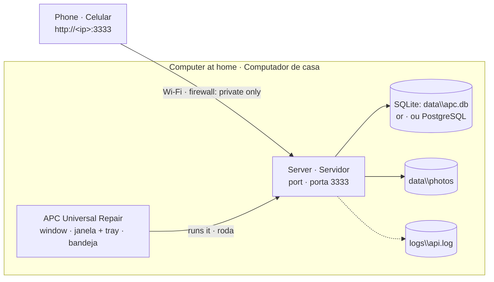

# Running at home · Rodando em casa

[🇺🇸 English](#-english-us) · [🇧🇷 Português](#-português-brasil)

How to run the APC server on a Windows computer at home, so the phone app on the same Wi-Fi, and the desktop app on that computer, use it. The server comes inside the desktop app: there is no project to download, no Node.js and no command to run. Written for whoever looks after that computer, not only for developers.

Como rodar o servidor do APC num computador Windows em casa, para o app do celular na mesma rede Wi-Fi, e o app desktop nesse computador, usarem ele. O servidor vem dentro do app desktop: não há projeto para baixar, nem Node.js, nem comando para rodar. Escrito para quem cuida desse computador, não só para quem programa.



---

## 🇺🇸 English (US)

> **Home network only.** The server asks for a login on every call, but has no HTTPS yet ([#216](https://github.com/ChrisCamilo/apc-universal-repair/issues/216)), so passwords and tokens cross the Wi-Fi in clear text. Never open port 3333 on the router or expose the computer to the internet.

### 1. Install the app

Download `APC-Universal-Repair-Setup-<version>.exe` from the latest [release](https://github.com/ChrisCamilo/apc-universal-repair/releases) and run it. Besides the folder, the installer asks two things:

- **Banco de dados:** SQLite or PostgreSQL, see step 2.
- **Iniciar com o Windows:** whether the app starts hidden in the tray when you sign in to Windows, with the server on, so the phone works without opening the app (yes by default). It can be changed later in *Iniciar com o Windows*, in the menu of the APC icon by the clock.

The server runs while the app runs. Closing the window keeps the app in the tray, by the clock, with the server on; *Sair* in the tray's menu quits the app and turns the server off. Its data is in `%APPDATA%\APC Universal Repair\data`, and its log in `%APPDATA%\APC Universal Repair\logs\api.log`. Uninstalling the app keeps the data.

The app updates itself: it checks the releases when it opens and every 6 hours, downloads a new version in the background, and installs it when it closes, or at once from the notice. The server updates with it, along with its database: on its first start after an update that brings new migrations, it copies the SQLite file to `data\backups` before applying them (see step 6).

### 2. Pick the database

- **SQLite, recommended for one computer:** nothing to install. The data stays in a file on this computer, `data\apc.db`, encrypted with a key the app keeps (see *The recovery key* below). There is no password to create, a backup is a copy of the folder, and only this computer reaches it.
- **PostgreSQL:** a separate database server, for whoever already uses PostgreSQL or wants more than one computer on the same database. Install it first: its installer asks for a password for the `postgres` user, so write it down, and it runs as a Windows service that starts with the computer (in `services.msc`, `postgresql-x64-<version>` should be *Running* and *Automatic*). Then create the database: in the Start menu, open *SQL Shell (psql)*, press Enter until it asks for the password, type it, and run:
  ```sql
  CREATE DATABASE apc_universal_repair;
  ```
  With PostgreSQL chosen at install, the app asks for its address the first time it opens, before the server starts: `postgresql://postgres:<password>@localhost:5432/apc_universal_repair`. *Usar SQLite* takes the file instead.

**Later, in the app.** *Servidor e banco de dados*, on the login screen, in the user menu and in the tray's menu, shows the database in use (SQLite with its folder, or PostgreSQL with its server), the photos' folder, the port and the phone's address.

- **To PostgreSQL:** pick *PostgreSQL*, type its address and choose *Usar PostgreSQL*. The app checks it connects, creates the tables in an empty database (or adds the new ones to an APC database of an earlier version), and restarts the server on it. It refuses a database of a newer APC, or one holding another program's tables, saying why. The address holds the password, so `config.json` keeps it only sealed by Windows (DPAPI), which this Windows user alone can open.
- **Back to SQLite:** pick *SQLite* and choose *Voltar ao SQLite*. The app forgets the address.
- **Switching doesn't move the data:** the server starts on the other database as it is. To bring the data along, import it (step 7), which needs the new database empty.

**The recovery key.** On SQLite, the file is encrypted, so a copy of it, on a USB drive or a stolen disk, can't be read. Its key is made the first time the server runs, and kept in `config.json` sealed by Windows, for this Windows user alone. The first time, the app shows the key's *recovery copy*, 8 groups of letters and numbers: write it on paper or keep it in a password manager, away from this computer, and choose *Já guardei a chave*. It shows on each opening until then. Without it, a copy of the file opens on no other computer, and the data is lost if Windows is reinstalled. A file from a version before this one is encrypted on its first start, by itself.

### 3. Allow it through the firewall

The first time the server starts, Windows asks whether *APC Universal Repair* may use the network. Tick **private networks only** and choose *Allow* (this needs an administrator's password). Don't press *Cancel*: that creates a rule that blocks the app, and the phone can't reach it.

Then make sure the Wi-Fi is a private network: in *Settings → Network & internet → Wi-Fi → (your network)*, set the network profile to **Private**.

If the prompt was missed or cancelled, look under *Windows Security → Firewall & network protection → Allow an app through firewall*: *APC Universal Repair* should be allowed on *Private*, and not blocked.

### 4. Reserve the computer's address

Find the computer's address with `ipconfig` in a PowerShell (the *IPv4 Address* of the Wi-Fi adapter, e.g. `192.168.0.10`). On the router's page, reserve that address for this computer (often called *DHCP reservation* or *address reservation*), using the MAC address that `ipconfig /all` shows as *Physical Address*. This way the address doesn't change and the phone keeps finding the server.

### 5. The phone

The tray's menu shows the address the phone reaches the server at, such as *Servidor ligado em http://192.168.0.10:3333*; a click copies it. The same address is in *Servidor e banco de dados*. To check it, open `http://<that address>/health` in the phone's browser, on the same Wi-Fi: it should answer `{"status":"ok",...}`.

The phone app needs a release APK built with that address. The steps to build and install it come with the Android release build ([#97](https://github.com/ChrisCamilo/apc-universal-repair/issues/97)).

If the phone gets no answer:

1. Is the app running, in the window or in the tray? On the computer, `http://localhost:3333/health` should answer.
2. Are the phone and the computer on the same Wi-Fi? A guest network usually keeps devices from seeing each other.
3. Is the network profile **Private**, and is the app allowed through the firewall on private networks (step 3)?
4. Did the computer's address change? Check the tray's menu and the reservation on the router.
5. Does `/health` answer *403 Forbidden* saying the server doesn't answer for that host? The phone is using a name, not the computer's address. Add the name to a Windows user environment variable `APC_ALLOWED_HOSTS` (comma separated, e.g. `oficina.local`), then quit the app with *Sair* and open it again.
6. Still nothing: look at the end of `%APPDATA%\APC Universal Repair\logs\api.log`.

### 6. Backup

Keep a copy of the data, for example once a week, on a USB drive or in the cloud.

**Before each update, by itself:** when an update brings new migrations, the server copies the SQLite file to `%APPDATA%\APC Universal Repair\data\backups` before applying them, as `apc-before-<version>-<date>.db`, named after the version that migrated it. Only the last 3 copies stay. A copy is encrypted with the same key as the file, and it must open before the server migrates: when it can't be made, the server doesn't migrate, and `logs\api.log` says why. To go back to one, as after an update that went wrong:

1. Quit the app with *Sair*.
2. Rename the copy to `apc.db` and put it in place of `data\apc.db`.
3. Install the version from before the one in the copy's name, from its [release](https://github.com/ChrisCamilo/apc-universal-repair/releases), and open it: the version in the name would migrate the copy again.

The copies are in the same folder as the data, so they don't replace a backup elsewhere. The photos aren't copied, since migrations don't touch them. PostgreSQL isn't copied: before an update, keep a `pg_dump` as below.

**SQLite:** quit the app with *Sair*, so the server is off, and copy the `%APPDATA%\APC Universal Repair\data` folder, which holds the database, encrypted, and the photos. Keep the recovery key apart from the copy. To restore on this computer and Windows user, with the app quit, put the folder back. On another computer, or after reinstalling Windows, install the app and import the copy's `apc.db` with its recovery key (step 7).

**PostgreSQL:** copy the `data\photos` folder as above, and the database with its tools, in its installation folder (adjust the version):

```powershell
& "C:\Program Files\PostgreSQL\18\bin\pg_dump.exe" -U postgres -F c -f apc-backup.dump apc_universal_repair
```

To restore, with the app quit, use `pg_restore` with the copy and put the photos folder back:

```powershell
& "C:\Program Files\PostgreSQL\18\bin\pg_restore.exe" -U postgres -d apc_universal_repair --clean apc-backup.dump
```

### 7. Importing an old server

*Importar dados de outro servidor*, in *Servidor e banco de dados*, brings an old server's data and photos, such as a clone's, into the database in use. That database must be empty: import before anyone signs up on the new install, opening *Servidor e banco de dados* from the login screen.

1. **Pick where the old data is:** *Arquivo SQLite*, such as an old clone's `apps\api\data\apc.db`, or *PostgreSQL*, its address (the `DATABASE_URL` in the old clone's `apps\api\.env`). A file from another install of the app, such as a backup, is encrypted: type its recovery key in *Chave de recuperação do arquivo*. A clone's file has none.
2. **Pick the old photos folder,** such as the old clone's `apps\api\uploads\photos`. Picking the SQLite file fills it in.
3. **Choose *Importar*.** When the old database is of an earlier version, the dialog says so and offers *Atualizar o banco antigo e importar*: it applies this version's migrations to it first, which change the old database's structure and keep its data. The server is off during the copy, and if anything fails nothing is kept. The dialog then lists each table's rows on both sides and the photo files copied.
4. **Close the dialog and log in** with the old accounts. Sessions aren't copied, so the phone logs in again too. Keep the old data until you're sure.

### 8. Moving off a clone

Up to v0.3.0, the server at home ran from a clone of the project, started by a Task Scheduler task or the *Ligar servidor APC* shortcut. To move such a computer to the server inside the app:

1. **Stop the clone's server for good.** In a PowerShell, in the clone's folder, run `powershell -ExecutionPolicy Bypass -File apps\api\scripts\uninstall-task.ps1`, which turns it off and removes its task. A task made with `-AtStartup` must be removed from a PowerShell opened as administrator. If the clone has no such script, open the Task Scheduler, delete the *APC Universal Repair API* task and restart the computer. Delete the *Ligar servidor APC* shortcut too. While the old server answers on port 3333, the app uses it instead of its own, and *Servidor e banco de dados* says so.
2. **Install the app** (step 1), or update it, and open it. If it was set to the clone with `apiDir` or `apiUrl` in `%APPDATA%\APC Universal Repair\config.json`, remove those settings, then quit with *Sair* and open it again. Don't sign up yet.
3. **Import the data** (step 7): the clone's `apps\api\data\apc.db` for SQLite, or the address in its `apps\api\.env` for PostgreSQL, with its `apps\api\uploads\photos`. Log in with an old account and check the inventory and its photos.
4. **Allow the app through the firewall** (step 3), and check the phone (step 5): the address stays the same. The old firewall rule for Node.js can be removed.
5. **Delete the clone** once you're sure, and uninstall Node.js, pnpm and Git if nothing else needs them. A PostgreSQL in use stays.

---

## 🇧🇷 Português (Brasil)

> **Só para a rede de casa.** O servidor pede login em toda chamada, mas ainda não tem HTTPS ([#216](https://github.com/ChrisCamilo/apc-universal-repair/issues/216)), então senhas e tokens passam pelo Wi-Fi em texto puro. Nunca abra a porta 3333 no roteador nem exponha o computador à internet.

### 1. Instalar o app

Baixe o `APC-Universal-Repair-Setup-<versão>.exe` da [release](https://github.com/ChrisCamilo/apc-universal-repair/releases) mais nova e rode. Além da pasta, o instalador pergunta duas coisas:

- **Banco de dados:** SQLite ou PostgreSQL, veja o passo 2.
- **Iniciar com o Windows:** se o app liga escondido na bandeja quando você entra no Windows, com o servidor ligado, para o celular funcionar sem abrir o app (sim por padrão). Dá para trocar depois em *Iniciar com o Windows*, no menu do ícone do APC perto do relógio.

O servidor roda enquanto o app roda. Fechar a janela deixa o app na bandeja, perto do relógio, com o servidor ligado; o *Sair* do menu da bandeja fecha o app e desliga o servidor. Os dados ficam em `%APPDATA%\APC Universal Repair\data`, e o log em `%APPDATA%\APC Universal Repair\logs\api.log`. Desinstalar o app mantém os dados.

O app se atualiza sozinho: ele consulta as releases ao abrir e a cada 6 horas, baixa a versão nova em segundo plano e a instala quando fecha, ou na hora pelo aviso. O servidor se atualiza junto, com o banco dele: na primeira vez que liga depois de uma atualização que traz migrações novas, ele copia o arquivo SQLite para `data\backups` antes de aplicá-las (veja o passo 6).

### 2. Escolher o banco de dados

- **SQLite, recomendado para um computador só:** nada para instalar. Os dados ficam num arquivo neste computador, o `data\apc.db`, criptografado com uma chave que o app guarda (veja *A chave de recuperação* abaixo). Não há senha para criar, o backup é copiar a pasta, e só este computador chega a ele.
- **PostgreSQL:** um servidor de banco de dados separado, para quem já usa PostgreSQL ou quer mais de um computador no mesmo banco. Instale-o antes: o instalador dele pede uma senha para o usuário `postgres`, então anote, e ele roda como um serviço do Windows que liga com o computador (no `services.msc`, o `postgresql-x64-<versão>` deve estar *Em execução* e *Automático*). Depois crie o banco: no menu Iniciar, abra o *SQL Shell (psql)*, aperte Enter até ele pedir a senha, digite-a e rode:
  ```sql
  CREATE DATABASE apc_universal_repair;
  ```
  Com o PostgreSQL escolhido na instalação, o app pede o endereço dele na primeira vez que abre, antes de ligar o servidor: `postgresql://postgres:<senha>@localhost:5432/apc_universal_repair`. O *Usar SQLite* fica com o arquivo no lugar.

**Depois, no app.** O *Servidor e banco de dados*, na tela de login, no menu do usuário e no menu da bandeja, mostra o banco em uso (o SQLite com a pasta dele, ou o PostgreSQL com o servidor dele), a pasta das fotos, a porta e o endereço do celular.

- **Para o PostgreSQL:** escolha *PostgreSQL*, digite o endereço e clique em *Usar PostgreSQL*. O app confere se ele conecta, cria as tabelas num banco vazio (ou acrescenta as novas num banco do APC de uma versão anterior) e religa o servidor nele. Ele recusa um banco de um APC mais novo, ou com tabelas de outro programa, dizendo por quê. O endereço tem a senha, então o `config.json` só o guarda lacrado pelo Windows (DPAPI), que só este usuário do Windows abre.
- **Voltar ao SQLite:** escolha *SQLite* e clique em *Voltar ao SQLite*. O app esquece o endereço.
- **Trocar não leva os dados:** o servidor liga no outro banco como ele está. Para levar os dados junto, importe-os (passo 7), o que pede o banco novo vazio.

**A chave de recuperação.** No SQLite, o arquivo é criptografado, então uma cópia dele, num pendrive ou num disco roubado, não pode ser lida. A chave dele é criada na primeira vez que o servidor liga, e guardada no `config.json` lacrada pelo Windows, só para este usuário do Windows. Na primeira vez, o app mostra a *cópia de recuperação* da chave, 8 grupos de letras e números: anote num papel ou guarde num gerenciador de senhas, longe deste computador, e clique em *Já guardei a chave*. Até lá, ela aparece toda vez que o app abre. Sem ela, uma cópia do arquivo não abre em nenhum outro computador, e os dados se perdem se o Windows for reinstalado. Um arquivo de uma versão anterior a esta é criptografado sozinho na primeira vez que o servidor liga.

### 3. Liberar no firewall

Na primeira vez que o servidor liga, o Windows pergunta se o *APC Universal Repair* pode usar a rede. Marque **só redes privadas** e clique em *Permitir* (isso pede a senha de um administrador). Não clique em *Cancelar*: isso cria uma regra que bloqueia o app, e o celular não chega a ele.

Depois confira que o Wi-Fi é uma rede privada: em *Configurações → Rede e internet → Wi-Fi → (sua rede)*, deixe o perfil de rede como **Privada**.

Se a pergunta passou ou foi cancelada, veja em *Segurança do Windows → Firewall e proteção de rede → Permitir um aplicativo pelo firewall*: o *APC Universal Repair* deve estar permitido em *Privada*, e não bloqueado.

### 4. Reservar o endereço do computador

Descubra o endereço do computador com o `ipconfig` num PowerShell (o *Endereço IPv4* do adaptador Wi-Fi, ex.: `192.168.0.10`). Na página do roteador, reserve esse endereço para este computador (costuma se chamar *reserva de DHCP* ou *reserva de endereço*), usando o endereço MAC que o `ipconfig /all` mostra como *Endereço Físico*. Assim o endereço não muda e o celular continua achando o servidor.

### 5. O celular

O menu da bandeja mostra o endereço em que o celular chega ao servidor, como *Servidor ligado em http://192.168.0.10:3333*; um clique o copia. O mesmo endereço está no *Servidor e banco de dados*. Para conferir, abra `http://<esse endereço>/health` no navegador do celular, no mesmo Wi-Fi: ele deve responder `{"status":"ok",...}`.

O app do celular precisa de um APK de release gerado com esse endereço. Os passos para gerar e instalar vêm com o build de release do Android ([#97](https://github.com/ChrisCamilo/apc-universal-repair/issues/97)).

Se o celular não tiver resposta:

1. O app está rodando, na janela ou na bandeja? No computador, o `http://localhost:3333/health` deve responder.
2. O celular e o computador estão no mesmo Wi-Fi? Uma rede de convidados costuma impedir que os aparelhos se vejam.
3. O perfil de rede está como **Privada**, e o app está liberado no firewall em redes privadas (passo 3)?
4. O endereço do computador mudou? Confira o menu da bandeja e a reserva no roteador.
5. O `/health` responde *403 Forbidden* dizendo que o servidor não responde para esse host? O celular está usando um nome, não o endereço do computador. Coloque o nome numa variável de ambiente do usuário do Windows, `APC_ALLOWED_HOSTS` (separados por vírgula, ex.: `oficina.local`), e depois feche o app pelo *Sair* e abra de novo.
6. Nada ainda: veja o fim do `%APPDATA%\APC Universal Repair\logs\api.log`.

### 6. Backup

Guarde uma cópia dos dados, por exemplo uma vez por semana, num pendrive ou na nuvem.

**Antes de cada atualização, sozinho:** quando uma atualização traz migrações novas, o servidor copia o arquivo SQLite para `%APPDATA%\APC Universal Repair\data\backups` antes de aplicá-las, como `apc-before-<versão>-<data>.db`, com o nome da versão que o migrou. Só as 3 últimas cópias ficam. Uma cópia é criptografada com a mesma chave do arquivo, e precisa abrir antes de o servidor migrar: quando ela não pode ser feita, o servidor não migra, e o `logs\api.log` diz por quê. Para voltar a uma delas, como depois de uma atualização que deu errado:

1. Feche o app pelo *Sair*.
2. Renomeie a cópia para `apc.db` e coloque-a no lugar do `data\apc.db`.
3. Instale a versão anterior à que está no nome da cópia, pela [release](https://github.com/ChrisCamilo/apc-universal-repair/releases) dela, e abra: a versão do nome migraria a cópia de novo.

As cópias ficam na mesma pasta dos dados, então não substituem um backup em outro lugar. As fotos não são copiadas, porque as migrações não mexem nelas. O PostgreSQL não é copiado: antes de uma atualização, guarde um `pg_dump` como abaixo.

**SQLite:** feche o app pelo *Sair*, para o servidor desligar, e copie a pasta `%APPDATA%\APC Universal Repair\data`, que tem o banco, criptografado, e as fotos. Guarde a chave de recuperação longe da cópia. Para restaurar neste computador e usuário do Windows, com o app fechado, coloque a pasta de volta. Em outro computador, ou depois de reinstalar o Windows, instale o app e importe o `apc.db` da cópia com a chave de recuperação dele (passo 7).

**PostgreSQL:** copie a pasta `data\photos` como acima, e o banco com as ferramentas dele, na pasta de instalação (ajuste a versão):

```powershell
& "C:\Program Files\PostgreSQL\18\bin\pg_dump.exe" -U postgres -F c -f apc-backup.dump apc_universal_repair
```

Para restaurar, com o app fechado, use o `pg_restore` com a cópia e coloque a pasta das fotos de volta:

```powershell
& "C:\Program Files\PostgreSQL\18\bin\pg_restore.exe" -U postgres -d apc_universal_repair --clean apc-backup.dump
```

### 7. Importar um servidor antigo

O *Importar dados de outro servidor*, no *Servidor e banco de dados*, traz os dados e as fotos de um servidor antigo, como o de um clone, para o banco em uso. Esse banco precisa estar vazio: importe antes de alguém criar uma conta na instalação nova, abrindo o *Servidor e banco de dados* pela tela de login.

1. **Escolha onde estão os dados antigos:** *Arquivo SQLite*, como o `apps\api\data\apc.db` de um clone antigo, ou *PostgreSQL*, o endereço dele (o `DATABASE_URL` do `apps\api\.env` do clone antigo). Um arquivo de outra instalação do app, como um backup, é criptografado: digite a chave de recuperação dele em *Chave de recuperação do arquivo*. O arquivo de um clone não tem.
2. **Escolha a pasta das fotos antigas,** como o `apps\api\uploads\photos` do clone antigo. Escolher o arquivo SQLite já a preenche.
3. **Clique em *Importar*.** Quando o banco antigo é de uma versão anterior, o diálogo avisa e oferece *Atualizar o banco antigo e importar*: ele aplica antes as migrações desta versão, que mudam a estrutura do banco antigo e mantêm os dados. O servidor fica desligado durante a cópia, e se algo falhar nada fica. O diálogo então lista as linhas de cada tabela nos dois lados e os arquivos de fotos copiados.
4. **Feche o diálogo e entre** com as contas antigas. As sessões não são copiadas, então o celular entra de novo também. Guarde os dados antigos até ter certeza.

### 8. Sair de um clone

Até a v0.3.0, o servidor de casa rodava de um clone do projeto, ligado por uma tarefa do Agendador de Tarefas ou pelo atalho *Ligar servidor APC*. Para passar um computador assim para o servidor dentro do app:

1. **Desligue de vez o servidor do clone.** Num PowerShell, na pasta do clone, rode `powershell -ExecutionPolicy Bypass -File apps\api\scripts\uninstall-task.ps1`, que o desliga e remove a tarefa. Uma tarefa feita com `-AtStartup` precisa ser removida num PowerShell aberto como administrador. Se o clone não tiver esse script, abra o Agendador de Tarefas, apague a tarefa *APC Universal Repair API* e reinicie o computador. Apague também o atalho *Ligar servidor APC*. Enquanto o servidor antigo responde na porta 3333, o app usa ele no lugar do próprio, e o *Servidor e banco de dados* avisa.
2. **Instale o app** (passo 1), ou atualize-o, e abra. Se ele estava apontado para o clone com `apiDir` ou `apiUrl` no `%APPDATA%\APC Universal Repair\config.json`, tire essas configurações, depois feche pelo *Sair* e abra de novo. Não crie conta ainda.
3. **Importe os dados** (passo 7): o `apps\api\data\apc.db` do clone para o SQLite, ou o endereço do `apps\api\.env` dele para o PostgreSQL, com o `apps\api\uploads\photos` dele. Entre com uma conta antiga e confira o estoque e as fotos.
4. **Libere o app no firewall** (passo 3) e confira o celular (passo 5): o endereço continua o mesmo. A regra antiga do firewall para o Node.js pode ser removida.
5. **Apague o clone** quando tiver certeza, e desinstale o Node.js, o pnpm e o Git se nada mais precisar deles. Um PostgreSQL em uso fica.
