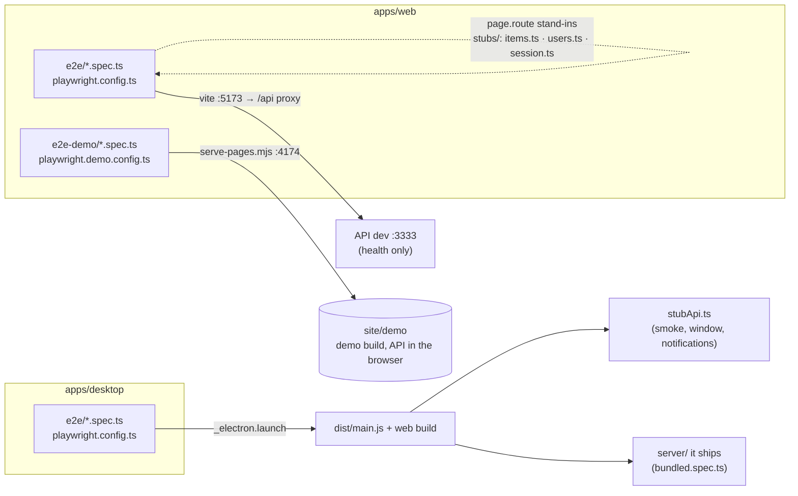

# Testing · Testes

[🇺🇸 English](#-english-us) · [🇧🇷 Português](#-português-brasil)

How the project's tests are laid out, how to run them, where to read their reports and how to keep them up. The rules every test follows (titles, the comment above each test, reduced motion, screen sizes) are in [AGENTS.md](../AGENTS.md#testing); this page explains how they are put in place, mostly for the Playwright suites.

Como os testes do projeto estão organizados, como rodá-los, onde ler os relatórios e como mantê-los. As regras que todo teste segue (títulos, o comentário acima de cada teste, movimento reduzido, tamanhos de tela) estão no [AGENTS.md](../AGENTS.md#testing); esta página explica como elas são aplicadas, sobretudo nas suítes do Playwright.



---

## 🇺🇸 English (US)

### Kinds of tests

| Kind | Tool | Where | Command |
|---|---|---|---|
| Unit (shared, API) | Node test runner (`tsx --test` on the API) | `packages/shared/src/**/*.test.ts`, `apps/api/src/**/*.test.ts` | `pnpm test` |
| API against a database | Node test runner, one file at a time | `apps/api/src/**/*.db-test.ts` | `pnpm --filter @apc/api test:db` |
| Component (web) | Vitest Browser Mode, Chromium through the Playwright provider | next to the component, `apps/web/src/**/*.test.tsx` | `pnpm test` |
| Mobile | Jest with `react-test-renderer` | `apps/mobile/__tests__/` | `pnpm test` |
| Desktop main process | Node test runner | `apps/desktop/src/*.test.ts` | `pnpm test` |
| **E2E (web)** | Playwright Test | `apps/web/e2e/*.spec.ts` | `pnpm --filter @apc/web test:e2e` |
| **E2E (web demo)** | Playwright Test | `apps/web/e2e-demo/*.spec.ts` | `pnpm --filter @apc/web test:e2e:demo` |
| **E2E (desktop)** | Playwright's Electron support | `apps/desktop/e2e/*.spec.ts` | `pnpm --filter @apc/desktop test:e2e` |

`pnpm test:e2e` at the root runs Turbo's `test:e2e`, which builds first (`dependsOn: ["build"]`) and then runs both the web and the desktop E2E. The demo's E2E is run on its own.

### The three Playwright suites

| | Web (`apps/web/playwright.config.ts`) | Demo (`apps/web/playwright.demo.config.ts`) | Desktop (`apps/desktop/playwright.config.ts`) |
|---|---|---|---|
| Runs against | Vite dev server on :5173, which proxies `/api` to the dev API on :3333 | The Pages site in `site/`, served by `scripts/serve-pages.mjs` on :4174 under `/apc-universal-repair/demo/` | The compiled app (`dist/main.js`) with the web build, opened by `_electron.launch` |
| Servers started | `pnpm --filter @apc/api run dev` and `pnpm dev` (`webServer`), reused locally only with `E2E_REUSE=1` | `serve-pages.mjs` | None: each spec starts its stand-in API or the app's own server |
| Projects | `desktop` 1280×720, `mobile` 360×780 (touch, `isMobile`) | the same two | none (one Electron app) |
| Parallelism | `fullyParallel` | `fullyParallel` | `workers: 1`, 60 s per test |
| Retries | 2 on CI, 0 locally | 2 on CI, 0 locally | 2 on CI, 0 locally |
| Reporter | `list` + `html` locally; `github` + `html` on CI | same, in `playwright-report-demo/` | same |
| Trace | `retain-on-failure` locally, `on-first-retry` on CI | same, in `test-results-demo/` | same, recorded by `launchApp` (see [Reports](#reports-and-traces)) |
| Screenshot | `only-on-failure` | `only-on-failure` | `only-on-failure` |
| Motion | `reducedMotion: "reduce"` | `reducedMotion: "reduce"` | `reduceMotion(app)` from `e2e/reducedMotion.ts` |

`forbidOnly` is on in CI, so a `test.only` left behind fails the run.

### Files

```
apps/web/
├── playwright.config.ts        # web E2E
├── playwright.demo.config.ts   # demo E2E
├── tsconfig.e2e.json           # typechecks e2e/, e2e-demo/ and both configs
├── e2e/
│   ├── support/
│   │   ├── fixtures.ts         # test and expect for every spec: session, stock, users, API guard
│   │   ├── expect.ts           # expect with not.toScrollSideways(); rgb() for computed colors
│   │   └── sizes.ts            # atNotebookSizes(): a check at 1360×768 and 1360×689
│   ├── stubs/
│   │   ├── session.ts          # signIn(): a saved session before the page loads
│   │   ├── users.ts            # serveUsers(): stand-in for sign-up, login, logout, tutorial
│   │   └── items.ts            # serveItems(), savedItem(): stand-in for /items and the item lists
│   ├── data/
│   │   └── items.ts            # item(): a test item from the fields that matter
│   ├── locators/               # the elements the specs find, one file per style-id scope:
│   │   ├── common.ts           # dialog(), dataTable(), pagination(), options(), toasts(), tour()
│   │   ├── auth.ts             # loginForm(), registerForm(), logIn()
│   │   ├── dashboard.ts        # dashboard(), userMenu(), logOut()
│   │   ├── inventory.ts        # inventory(), itemForm(), itemDetails(), deleteDialog(), manageLists()…
│   │   ├── notifications.ts    # bell()
│   │   └── catalog.ts          # catalog()
│   ├── api-guard.spec.ts       # checks the guard fails a call no stand-in answers
│   ├── seed.spec.ts            # where Playwright's test agents start (below)
│   └── <area>.spec.ts          # catalog, dashboard, export, guard, health, inventory, login,
│                               # notifications, register, theme, toast, user-menu
├── e2e-demo/
│   └── demo.spec.ts
└── specs/                      # the test plans of Playwright's planner agent

apps/desktop/
├── playwright.config.ts
└── e2e/
    ├── support/fixtures.ts     # test and expect for every spec: launchApp, stubApi, logIn()
    ├── reducedMotion.ts        # reduceMotion(app): every window reports reduced motion
    ├── stubApi.ts              # startStubApi(items): a stand-in API on a free port
    ├── smoke.spec.ts           # sign in, restart, bridge without Node, installer's database choice
    ├── window.spec.ts          # the 1360×689 notebook window
    ├── notifications.spec.ts   # Windows notifications
    └── bundled.spec.ts         # the server the app ships: SQLite key, import, ports, tray, PostgreSQL
```

Test data shared with the other kinds of tests lives in `@apc/shared`: `TEST_USERS` (`@apc/shared/test-users`), `testItem()` (`@apc/shared/test-items`), `itemListsOf()` (`@apc/shared/test-lists`). Screen sizes come from `@apc/shared/screens`, messages from the shared modules (`LOGIN_MESSAGES`, `REGISTER_MESSAGES`…), so a test never repeats a number or a message.

### How the web E2E stand in for the API

The web E2E don't depend on a database. Apart from `health.spec.ts`, which checks the web app reaches the real API through the proxy (`page.request` doesn't go through the page's routes), every spec answers the API in the page with `page.route`.

Every spec imports `test` and `expect` from `e2e/support/fixtures.ts`, not from `@playwright/test`. Its `page` starts with:

- **a test user logged in,** unless the spec says `test.use({ signedIn: false })`, as the login, sign-up and guard specs do for the screens before the login;
- **the spec's stock:** `test.use({ stock: { items: ITEMS } })` for the items `GET /api/items` answers with, copied for each test; none by default;
- **the users' stand-in,** whose list a test reads from the `users` fixture to check a sign-up;
- **the API guard:** any `/api/**` call no stand-in or test answered gets a 501, and the test fails after it ends, listing each call. So a test never reaches whatever API listens on port 3333, and a call a test forgot shows up in its result.

The fixtures use these stand-ins, which a test may also start itself, with items of its own:

- **`signIn(page, tutorialSeen?, user?)`** saves a test user's session in `localStorage` with `addInitScript`, before any script of the app runs, so a test starts on the Dashboard. The token is `token-<id>`, which no stand-in checks. Marking the tutorial seen is answered with a 204.
- **`serveUsers(page)`** answers sign-up (`POST /api/users`), login (`POST /api/sessions`), the tutorial and logout, from `TEST_USERS` and whoever signs up meanwhile. It returns the users it knows, so a test can check a sign-up.
- **`serveItems(page, stock, onQuery?)`** answers `GET /api/items` with search, filters, sorting and pages as the API does, and the item lists (create, rename, merge, delete). `stock` is read on every request, so a test may change it as it goes. Methods other than GET on `/api/items` fall through (`route.fallback()`) to the routes the test registered **before** it.
- **`savedItem(sent, held?)`** builds what the API answers for a create or an edit.

Playwright tries the routes last registered first. The fixtures register the guard first, so it is tried last, then the session and the stock, then the users; the test's own routes come after all of them. So a test that answers a write itself registers its `page.route("**/api/items", …)` before its own `serveItems`, and a test that must override a GET (an expired session, an API error) registers it after. A test never calls `page.unrouteAll()`, which would take the guard away too.

Routes, `localStorage` and the init scripts belong to the test's own browser context, which Playwright throws away after each test: no `afterEach` is needed to clean up.

### How the desktop E2E run

Every spec imports `test` and `expect` from `e2e/support/fixtures.ts`. A test opens the app with the `launchApp` fixture, as often as it needs:

```ts
test("Desktop: …", { tag: [TEST_TAGS.setup] }, async ({ launchApp }) => {
  const { app, userData, server } = await launchApp({ files: { "installer-database.txt": "postgresql" } });
```

- **Its options:** `args` after the app's folder (`--hidden`), `files` to leave in `userData` first (the installer's answers, a `config.json`), the `userData` of an earlier launch of the same test, to open again (a restart), and the `port` for the shipped server.
- **It returns** the running app, its `userData` and the address of the server it uses.
- **Each launch gets its own `userData`** under the system's temporary folder (`apc-desktop-*`), so a test never touches the installed app's data. It also deletes `ELECTRON_RUN_AS_NODE` from the app's environment (with it set, Electron runs as plain Node) and makes every window report reduced motion.
- **Once the test ends, passed or failed,** every app it opened that is still running is closed, with the server it ships, and the `userData` folders it made are removed. So a failed assertion leaves no Electron, port or file for the next test on the one worker, and a test needs no `try/finally` and no last `app.close()`. It still closes an app itself to open the same `userData` again, or to check what quitting does.
- **Stand-in API** (the default, `smoke`, `window`, `notifications`): the worker-scoped `stubApi` fixture, started once for the spec's tests, whose address the app gets in `APC_API_URL`. It answers health, the test users' login, the tutorial, logout, `/items` and empty item lists, only for requests that carry a test user's token and are addressed to `127.0.0.1`/`localhost`. `test.use({ stubStock: { items: ITEMS } })` gives `GET /items` its items.
- **The server the app ships** (`bundled`): `test.use({ server: "bundled" })`. No `APC_API_URL`, a free port in `APC_SERVER_PORT`, and the app's own SQLite in its `userData`. A fresh install shows its recovery key first, which `keepRecoveryKey()` keeps.
- **`logIn(page, user)`** types a user into the login and waits for the Inventory.
- **A failed test** gets a trace of each app it opened, which `launchApp` records ([Reports](#reports-and-traces)).

### Tags

Every Playwright test, web, demo and desktop, has one area tag and the kind tags that apply. They come from `TEST_TAGS` in `@apc/shared/test-tags`, so a typo doesn't compile:

```ts
test("Web: items are added and edited through the item form", { tag: [TEST_TAGS.inventory, TEST_TAGS.smoke] }, async ({ page }) => {
```

| Tag | Tests |
|---|---|
| `@auth`, `@dashboard`, `@catalog`, `@inventory`, `@notifications`, `@setup` | The area: the style-id scope the test covers. Each test has exactly one. |
| `@smoke` | The flows a release needs: the web app reaching the API, the login, the Inventory's list, creating and editing an item, the desktop's sign-in |
| `@layout` | Sizes and scrolling |
| `@theme` | The styles and modes |
| `@motion` | A motion, with reduced motion off |
| `@demo` | The demo, as Pages serves it |
| `@bundled` | The desktop app with the server it ships, much slower than with the stand-in API |
| `@desktop-only` | A desktop screen: the web's `mobile` project leaves it out (`grepInvert` in `playwright.config.ts`) instead of skipping it |

The title keeps its prefix (`Web:`, `Desktop:`), and the tags follow it in the report. A test skipped until an issue is done says so in an `issue` annotation, as the Catalog's do for #151.

### Writing a test

1. Put it in the spec of its area (`inventory.spec.ts` for the Inventory). A new area gets a new `<area>.spec.ts`.
2. Title it with the prefix, `Web:` or `Desktop:`, and the behavior in English; write what it checks and why in a comment right above it ([AGENTS.md](../AGENTS.md#writing-tests)). Give it its area tag and the kind tags that apply ([Tags](#tags)).
3. Import `test` and `expect` from `./support/fixtures.ts` and start from the state it needs: the Dashboard with a test user is the default, `test.use({ signedIn: false })` for the screens before the login, `test.use({ stock: { items } })` or `serveItems()` with only the items that matter (`item()` from `./data/items.ts` fills in the rest). Answer every API call the test makes: the guard fails any it doesn't.
4. Find elements through `./locators/<scope>.ts`, the file of the scope of the element's style id: `itemForm(page, "Novo item").save`, `dataTable(page).rows`, and flows many specs repeat, such as `logIn()`, `fillItem()` and `deleteItem()`. An element a spec reaches more than once is added there, with no assertions. A locator finds an element as a user does, in this order: `getByRole` with the accessible name, `getByLabel`, `getByText`. It uses the style id (`getByTestId("inventory.inventory-tab.filters.count")`) for an element with no role or text of its own, and CSS only for what has none of these (`html`, `body`, `header`). The demo's spec uses the same locators.
5. Assert with Playwright's web-first assertions (`toBeVisible`, `toHaveText`, `toHaveURL`), `expect.poll` for a value read from the page. Never wait a fixed time. A color in `toHaveCSS` comes from the theme through `rgb()`, and a page that must not scroll sideways is checked with `await expect(page).not.toScrollSideways()`, both from `./support/expect.ts`.
6. Check the minimum sizes: the test runs in both projects. A test that only holds on a desktop screen gets `TEST_TAGS.desktopOnly`, and the `mobile` project leaves it out. A test that differs on the phone reads Playwright's `isMobile` fixture, never the project's name. Screens that fill the window are also checked on a notebook, in full screen and in a window, with `atNotebookSizes(page, async (size) => …)` from `./support/sizes.ts`, naming `size` in each assertion's message.
7. A test about a motion turns it on for itself: `page.emulateMedia({ reducedMotion: "no-preference" })`.

### Writing tests with Playwright's agents

Claude Code can read the app as a test does, and plan, write and fix tests by running them, through Playwright's MCP and its test agents:

| | What it is | Where |
|---|---|---|
| `playwright` | Playwright's MCP (`@playwright/mcp` 0.0.80, on Playwright 1.63 and its Chromium): a browser at 1280×720 with a profile kept in memory, which Claude Code drives by the page's accessibility tree | `.mcp.json` |
| `playwright-test` | The test runner's MCP: it opens the page from a seed spec, records what the generator does, writes a test file, and runs and debugs the tests through `apps/web/playwright.config.ts` | `.mcp.json` |
| `playwright-test-planner`, `playwright-test-generator`, `playwright-test-healer` | Playwright's test agents, made by `playwright init-agents --loop=claude`, with the project's rules added | `.claude/agents/` |
| `e2e/seed.spec.ts` | The seed: the Dashboard with a test user and an empty stock, from the fixtures | `apps/web/` |
| `specs/` | The planner's test plans | `apps/web/` |

**Setting it up.** Open Claude Code at the repository's root and approve the two servers of `.mcp.json` when it asks; `/mcp` lists them. Both start through `cmd /c`, as Windows needs. The browser is Playwright's Chromium, downloaded with `playwright install chromium` ([Running the tests](#running-the-tests)). The servers save their page snapshots in `.playwright-mcp/`, which is in `.gitignore`. [CLAUDE.md](../CLAUDE.md#tests-made-with-playwrights-agents) has the rules every test they make follows.

**Exploring a screen.** Ask Claude Code to open the demo with the `playwright` server, on the Pages site (https://chriscamilo.github.io/apc-universal-repair/demo/) or from `site/` served on :4174, and read the screen's accessibility tree: the roles and names a locator needs are there. Never point it at the web app on an API you didn't start: a server on port 3333 may be the installed desktop app, with real data.

**From a screen to a test.**

1. Ask for the `playwright-test-planner` agent. It opens the app from the seed, on the API and web app the test server's run starts itself, explores the screen, and saves a plan in `apps/web/specs/<screen-or-flow>.plan.md`.
2. Ask for the `playwright-test-generator` agent with a scenario of the plan. It does each step on the page and writes the test to a new `e2e/<scope>-<behavior>.spec.ts`, never to a spec that exists, as its tool replaces the whole file.
3. Bring the test into the project's shape, as CLAUDE.md says: its locators into `e2e/locators/<scope>.ts`, the title prefix, the comment above it, the tags, and no comment before each step. Move it into its area's spec when there is one.
4. Run it in both projects, then the whole suite ([Running the tests](#running-the-tests)).

**Fixing a failing test.** Ask for the `playwright-test-healer` agent. It runs the tests, pauses on a failure with the page's snapshot, fixes the test and runs it again. It never weakens an assertion, skips the test or adds a wait: when the app is wrong, it leaves the test failing and says what the app does.

**Reviewing what the agents change.** Read the diff as any other, and check:

- every assertion the test had is still there, with the same expected values, unless the app's intended behavior changed;
- there is no `waitForTimeout`, longer timeout, `test.fixme()` or `test.skip()`;
- the locators come from `e2e/locators/`, and the state from the fixtures, not from steps that build it;
- the test adds coverage no other test has. Otherwise drop it, with its plan.

**After an update of Playwright,** `playwright init-agents --loop=claude` in `apps/web` writes the new agents to `apps/web/.claude/agents/`, with a seed and a `.mcp.json` of its own. Move the agents to `.claude/agents/` and add back the project's paragraphs, keep `e2e/seed.spec.ts` and the root's `.mcp.json`, and pin the `@playwright/mcp` release built on the same Playwright.

### Running the tests

Before the first run, download Chromium:

```bash
pnpm --filter @apc/web exec playwright install chromium
```

| Command | What it does |
|---|---|
| `pnpm --filter @apc/web test:e2e` | Web E2E, both projects |
| `pnpm --filter @apc/web exec playwright test e2e/login.spec.ts` | One spec |
| `pnpm --filter @apc/web exec playwright test e2e/login.spec.ts:31` | The test on that line |
| `pnpm --filter @apc/web exec playwright test -g "user menu"` | Tests whose title matches |
| `pnpm --filter @apc/web test:e2e:smoke` | The `@smoke` tests; `@apc/desktop` has the same script |
| `pnpm --filter @apc/web exec playwright test --grep @inventory` | The tests with a tag; `--grep-invert @layout` leaves a tag out |
| `pnpm --filter @apc/web exec playwright test --list --grep @smoke` | Lists the tests with a tag, without running them |
| `pnpm --filter @apc/web exec playwright test --project=mobile` | Only the 360×780 project |
| `pnpm --filter @apc/web test:e2e:ui` | UI mode: pick, watch and time-travel the tests |
| `pnpm --filter @apc/web exec playwright test --headed` | With the browser on screen |
| `pnpm --filter @apc/web exec playwright test --debug` | Step by step in the Playwright Inspector |
| `pnpm --filter @apc/web exec playwright codegen localhost:5173` | Records clicks as locators, to start a test from |
| `pnpm --filter @apc/web test:e2e:demo` | Demo E2E (put `site/` together first, below) |
| `pnpm --filter @apc/desktop test:e2e` | Desktop E2E (build the web app and the desktop app first) |

**The web run starts its own API and web app.** If something already answers on port 3333 or 5173, the run fails with `… is already used`: on 3333 that may be the installed desktop app, serving its real data. Close it, or find who holds the port in PowerShell (nothing printed means nothing listens there):

```powershell
Get-NetTCPConnection -LocalPort 3333 -State Listen -ErrorAction SilentlyContinue | ForEach-Object { Get-CimInstance Win32_Process -Filter "ProcessId=$($_.OwningProcess)" | Select-Object ProcessId, CommandLine }
```

To reuse an API and a web app you started yourself (`pnpm dev`), for quicker runs, set `E2E_REUSE=1`. Check who answers on 3333 first: the web E2E only send fake tokens, but a test should never reach real data.

```bash
E2E_REUSE=1 pnpm --filter @apc/web test:e2e
```

**Demo:** the suite runs on the site as Pages serves it, so put it together in `site/` as the Pages workflow does:

```bash
pnpm --filter @apc/web run build:demo
```

```bash
mkdir -p site && rm -rf site/demo && cp -r apps/web/dist-demo site/demo && cp docs/site/404.html site/
```

```bash
pnpm --filter @apc/web test:e2e:demo
```

**Desktop:** build both apps, then run the suite:

```bash
pnpm turbo run build --filter=@apc/web --filter=@apc/desktop
```

```bash
pnpm --filter @apc/desktop test:e2e
```

### Reports and traces

- **A failed test leaves a trace, a screenshot and the HTML report,** locally and on CI. Locally every test records a trace, kept only when it fails (`retain-on-failure`); on CI the first retry records one (`on-first-retry`). The terminal still lists the results; the HTML report is written on every run and never opens by itself:

  | Suite | HTML report | Traces and screenshots |
  |---|---|---|
  | Web | `apps/web/playwright-report/` | `apps/web/test-results/<test>/` |
  | Demo | `apps/web/playwright-report-demo/` | `apps/web/test-results-demo/<test>/` |
  | Desktop | `apps/desktop/playwright-report/` | `apps/desktop/test-results/<test>/` |

  ```bash
  pnpm --filter @apc/web exec playwright show-report
  ```

  `show-report playwright-report-demo` opens the demo's; `pnpm --filter @apc/desktop exec playwright show-report`, the desktop's.
- **A trace** opens from the failed test's page in the report, or with (`exec` runs in `apps/web`, so the path starts there):

  ```bash
  pnpm --filter @apc/web exec playwright show-trace test-results/<test>/trace.zip
  ```

  To keep one of a test that passes, pass `--trace on`.
- **Desktop:** Playwright's screenshot captures the app's windows, but its `trace.zip` holds only the test's steps. So `launchApp` records each app the test opened by the same `trace` option, in `trace-1.zip`, `trace-2.zip`…, attached to the test. An app's trace is saved as it closes, through the test's `app.close()` or once the test ends; an app that quits some other way has none.
- **On CI** the `github` reporter puts each failure on the pull request's lines, and the HTML report is uploaded when the job fails, kept 7 days:

  | Workflow | Suite | Artifact |
  |---|---|---|
  | `ci.yml` (every pull request and push to main) | Web E2E | `playwright-report` |
  | `desktop.yml` (pull requests that touch the desktop, web or shared) | Desktop E2E, on `windows-latest` | `desktop-playwright-report` |
  | `pages.yml` (pull requests that touch the API, web, shared or the site) | Demo E2E | `demo-playwright-report` |

  Download the artifact from the run's *Summary* page, unzip it and open it with `playwright show-report <folder>`. The traces of the retried tests are inside.
- `test-results/`, `playwright-report/`, the demo's `test-results-demo/` and `playwright-report-demo/`, and `blob-report/` are in `.gitignore`.

### Keeping the tests up

- **UI copy changes:** the E2E find elements by their Portuguese names. Rename the text in the test too, or better, read it from the shared module that already holds it (`LOGIN_MESSAGES`, `REGISTER_MESSAGES`, `ENGINE_SHEETS`), as the login and sign-up specs do.
- **API changes:** a route added or changed reaches three stand-ins: `apps/web/e2e/stubs/items.ts`/`users.ts` (web E2E), `apps/desktop/e2e/stubApi.ts` (desktop E2E) and `apps/web/src/demo/demoApi.ts` (the demo; CI checks this one against `@apc/shared/api-routes`). The first two are not checked: update them in the same pull request.
- **Style ids change** with a component's file name or slots. A test that reads one fails with "element not found": search the id in `e2e/locators/` and follow the new one there, and the specs follow too. A renamed label is changed there the same way.
- **A work-in-progress tab** keeps its tests skipped (`catalog.spec.ts` while the Catalog tab has `wip`). They come back by themselves once `wip` is gone.
- **A flaky test:** run it many times to see it fail (`--repeat-each=20 --workers=4`), record a trace (`--trace on`), and fix the wait, not the timeout: wait for what the user would see (`toBeVisible`, `toHaveURL`, `expect.poll`), never `waitForTimeout`.
- **Upgrading Playwright:** `@playwright/test` and `playwright` in `apps/web`, `@playwright/test` in `apps/desktop` and `@vitest/browser-playwright` move together. Then download the browser again (`playwright install chromium`); CI installs it on each run.

---

## 🇧🇷 Português (Brasil)

### Tipos de teste

| Tipo | Ferramenta | Onde | Comando |
|---|---|---|---|
| Unitário (shared, API) | test runner do Node (`tsx --test` na API) | `packages/shared/src/**/*.test.ts`, `apps/api/src/**/*.test.ts` | `pnpm test` |
| API contra um banco | test runner do Node, um arquivo por vez | `apps/api/src/**/*.db-test.ts` | `pnpm --filter @apc/api test:db` |
| Componente (web) | Vitest Browser Mode, Chromium pelo provider do Playwright | ao lado do componente, `apps/web/src/**/*.test.tsx` | `pnpm test` |
| Celular | Jest com `react-test-renderer` | `apps/mobile/__tests__/` | `pnpm test` |
| Processo principal do desktop | test runner do Node | `apps/desktop/src/*.test.ts` | `pnpm test` |
| **E2E (web)** | Playwright Test | `apps/web/e2e/*.spec.ts` | `pnpm --filter @apc/web test:e2e` |
| **E2E (demo da web)** | Playwright Test | `apps/web/e2e-demo/*.spec.ts` | `pnpm --filter @apc/web test:e2e:demo` |
| **E2E (desktop)** | suporte a Electron do Playwright | `apps/desktop/e2e/*.spec.ts` | `pnpm --filter @apc/desktop test:e2e` |

`pnpm test:e2e` na raiz roda o `test:e2e` do Turbo, que faz o build antes (`dependsOn: ["build"]`) e depois roda os E2E da web e do desktop. O E2E da demo roda à parte.

### As três suítes do Playwright

| | Web (`apps/web/playwright.config.ts`) | Demo (`apps/web/playwright.demo.config.ts`) | Desktop (`apps/desktop/playwright.config.ts`) |
|---|---|---|---|
| Roda contra | O servidor de desenvolvimento do Vite na :5173, que repassa `/api` para a API de desenvolvimento na :3333 | O site do Pages em `site/`, servido pelo `scripts/serve-pages.mjs` na :4174 em `/apc-universal-repair/demo/` | O app compilado (`dist/main.js`) com o build da web, aberto pelo `_electron.launch` |
| Servidores que sobe | `pnpm --filter @apc/api run dev` e `pnpm dev` (`webServer`), reaproveitados localmente só com `E2E_REUSE=1` | `serve-pages.mjs` | Nenhum: cada spec sobe sua API substituta ou o servidor do próprio app |
| Projetos | `desktop` 1280×720, `mobile` 360×780 (toque, `isMobile`) | os mesmos dois | nenhum (um app Electron) |
| Paralelismo | `fullyParallel` | `fullyParallel` | `workers: 1`, 60 s por teste |
| Retentativas | 2 no CI, 0 local | 2 no CI, 0 local | 2 no CI, 0 local |
| Reporter | `list` + `html` local; `github` + `html` no CI | igual, em `playwright-report-demo/` | igual |
| Trace | `retain-on-failure` local, `on-first-retry` no CI | igual, em `test-results-demo/` | igual, gravado pelo `launchApp` (veja [Relatórios](#relatórios-e-traces)) |
| Screenshot | `only-on-failure` | `only-on-failure` | `only-on-failure` |
| Movimento | `reducedMotion: "reduce"` | `reducedMotion: "reduce"` | `reduceMotion(app)` de `e2e/reducedMotion.ts` |

O `forbidOnly` fica ligado no CI, então um `test.only` esquecido derruba a execução.

### Arquivos

```
apps/web/
├── playwright.config.ts        # E2E da web
├── playwright.demo.config.ts   # E2E da demo
├── tsconfig.e2e.json           # checa os tipos de e2e/, e2e-demo/ e das duas configs
├── e2e/
│   ├── support/
│   │   ├── fixtures.ts         # test e expect de toda spec: sessão, estoque, usuários, guarda da API
│   │   ├── expect.ts           # expect com not.toScrollSideways(); rgb() para cores calculadas
│   │   └── sizes.ts            # atNotebookSizes(): uma conferência em 1360×768 e 1360×689
│   ├── stubs/
│   │   ├── session.ts          # signIn(): uma sessão salva antes de a página carregar
│   │   ├── users.ts            # serveUsers(): substituto do cadastro, login, logout e tutorial
│   │   └── items.ts            # serveItems(), savedItem(): substituto de /items e das listas de itens
│   ├── data/
│   │   └── items.ts            # item(): um item de teste a partir dos campos que importam
│   ├── locators/               # os elementos que as specs encontram, um arquivo por escopo de style id:
│   │   ├── common.ts           # dialog(), dataTable(), pagination(), options(), toasts(), tour()
│   │   ├── auth.ts             # loginForm(), registerForm(), logIn()
│   │   ├── dashboard.ts        # dashboard(), userMenu(), logOut()
│   │   ├── inventory.ts        # inventory(), itemForm(), itemDetails(), deleteDialog(), manageLists()…
│   │   ├── notifications.ts    # bell()
│   │   └── catalog.ts          # catalog()
│   ├── api-guard.spec.ts       # confere que a guarda reprova uma chamada que nenhum substituto responde
│   ├── seed.spec.ts            # de onde partem os agentes de teste do Playwright (abaixo)
│   └── <área>.spec.ts          # catalog, dashboard, export, guard, health, inventory, login,
│                               # notifications, register, theme, toast, user-menu
├── e2e-demo/
│   └── demo.spec.ts
└── specs/                      # os planos de teste do agente planejador do Playwright

apps/desktop/
├── playwright.config.ts
└── e2e/
    ├── support/fixtures.ts     # test e expect de toda spec: launchApp, stubApi, logIn()
    ├── reducedMotion.ts        # reduceMotion(app): toda janela informa movimento reduzido
    ├── stubApi.ts              # startStubApi(items): uma API substituta numa porta livre
    ├── smoke.spec.ts           # login, reinício, ponte sem Node, banco escolhido no instalador
    ├── window.spec.ts          # a janela de 1360×689 do notebook
    ├── notifications.spec.ts   # notificações do Windows
    └── bundled.spec.ts         # o servidor que o app traz: chave do SQLite, importação, portas, bandeja, PostgreSQL
```

Os dados de teste compartilhados com os outros tipos de teste ficam no `@apc/shared`: `TEST_USERS` (`@apc/shared/test-users`), `testItem()` (`@apc/shared/test-items`), `itemListsOf()` (`@apc/shared/test-lists`). Os tamanhos de tela vêm de `@apc/shared/screens` e as mensagens dos módulos compartilhados (`LOGIN_MESSAGES`, `REGISTER_MESSAGES`…), então um teste nunca repete um número ou uma mensagem.

### Como o E2E da web substitui a API

O E2E da web não depende de banco. Fora o `health.spec.ts`, que confere que o app web alcança a API de verdade pelo proxy (o `page.request` não passa pelas rotas da página), toda spec responde a API dentro da página com `page.route`.

Toda spec importa `test` e `expect` de `e2e/support/fixtures.ts`, não de `@playwright/test`. A `page` dela começa com:

- **um usuário de teste logado,** a não ser que a spec diga `test.use({ signedIn: false })`, como fazem as specs de login, cadastro e guarda para as telas antes do login;
- **o estoque da spec:** `test.use({ stock: { items: ITEMS } })` para os itens que o `GET /api/items` responde, copiados para cada teste; nenhum por padrão;
- **o substituto dos usuários,** cuja lista o teste lê na fixture `users` para conferir um cadastro;
- **a guarda da API:** toda chamada a `/api/**` que nenhum substituto ou teste respondeu recebe um 501, e o teste falha quando termina, listando cada chamada. Assim um teste nunca alcança a API que estiver escutando na porta 3333, e uma chamada esquecida aparece no resultado dele.

As fixtures usam estes substitutos, que um teste também pode iniciar ele mesmo, com itens próprios:

- **`signIn(page, tutorialSeen?, user?)`** salva a sessão de um usuário de teste no `localStorage` com `addInitScript`, antes de qualquer script do app rodar, para o teste começar no Dashboard. O token é `token-<id>`, que nenhum substituto confere. Marcar o tutorial como visto é respondido com 204.
- **`serveUsers(page)`** responde o cadastro (`POST /api/users`), o login (`POST /api/sessions`), o tutorial e o logout, a partir de `TEST_USERS` e de quem se cadastrar no meio do teste. Devolve os usuários que conhece, para o teste conferir um cadastro.
- **`serveItems(page, stock, onQuery?)`** responde `GET /api/items` com busca, filtros, ordenação e páginas como a API faz, e as listas de itens (criar, renomear, mesclar, excluir). O `stock` é lido a cada requisição, então o teste pode alterá-lo no caminho. Métodos que não são GET em `/api/items` passam adiante (`route.fallback()`) para as rotas que o teste registrou **antes** dele.
- **`savedItem(sent, held?)`** monta o que a API responde a uma criação ou edição.

O Playwright tenta primeiro as rotas registradas por último. As fixtures registram primeiro a guarda, que assim é tentada por último, depois a sessão e o estoque, depois os usuários; as rotas do próprio teste vêm depois de todas. Então um teste que responde ele mesmo a uma escrita registra o seu `page.route("**/api/items", …)` antes do seu `serveItems`, e um teste que precisa sobrepor um GET (sessão expirada, erro da API) registra depois. Um teste nunca chama `page.unrouteAll()`, que tiraria a guarda também.

Rotas, `localStorage` e init scripts pertencem ao contexto de navegador do próprio teste, que o Playwright descarta depois de cada teste: não é preciso `afterEach` para limpar.

### Como o E2E do desktop roda

Toda spec importa `test` e `expect` de `e2e/support/fixtures.ts`. Um teste abre o app com a fixture `launchApp`, quantas vezes precisar:

```ts
test("Desktop: …", { tag: [TEST_TAGS.setup] }, async ({ launchApp }) => {
  const { app, userData, server } = await launchApp({ files: { "installer-database.txt": "postgresql" } });
```

- **As opções dela:** `args` depois da pasta do app (`--hidden`), `files` para deixar no `userData` antes (as respostas do instalador, um `config.json`), o `userData` de uma abertura anterior do mesmo teste, para abrir de novo (um reinício), e a `port` do servidor que o app traz.
- **Ela devolve** o app rodando, o `userData` dele e o endereço do servidor que ele usa.
- **Cada abertura ganha seu próprio `userData`** na pasta temporária do sistema (`apc-desktop-*`), então um teste nunca mexe nos dados do app instalado. Ela também apaga `ELECTRON_RUN_AS_NODE` do ambiente do app (com ela definida, o Electron roda como Node puro) e faz toda janela informar movimento reduzido.
- **Quando o teste termina, passando ou falhando,** todo app que ele abriu e ainda está rodando é fechado, com o servidor que traz, e as pastas `userData` que ele criou são apagadas. Assim uma asserção que falha não deixa Electron, porta nem arquivo para o próximo teste no único worker, e um teste não precisa de `try/finally` nem de um último `app.close()`. Ele ainda fecha um app por conta própria para abrir o mesmo `userData` de novo, ou para conferir o que sair do app faz.
- **API substituta** (o padrão; `smoke`, `window`, `notifications`): a fixture `stubApi`, com escopo de worker, iniciada uma vez para os testes da spec; o app recebe o endereço dela em `APC_API_URL`. Responde health, o login dos usuários de teste, o tutorial, o logout, `/items` e listas de itens vazias, só para requisições que levam o token de um usuário de teste e são endereçadas a `127.0.0.1`/`localhost`. O `test.use({ stubStock: { items: ITEMS } })` dá os itens do `GET /items`.
- **O servidor que o app traz** (`bundled`): `test.use({ server: "bundled" })`. Sem `APC_API_URL`, uma porta livre em `APC_SERVER_PORT` e o SQLite do próprio app no `userData` dele. Uma instalação nova mostra primeiro a chave de recuperação, que o `keepRecoveryKey()` guarda.
- **`logIn(page, user)`** digita um usuário no login e espera o Estoque.
- **Um teste que falha** ganha um trace de cada app que abriu, gravado pelo `launchApp` ([Relatórios](#relatórios-e-traces)).

### Tags

Todo teste do Playwright, da web, da demo e do desktop, tem uma tag de área e as tags de tipo que se aplicam. Elas vêm de `TEST_TAGS` em `@apc/shared/test-tags`, então um erro de digitação não compila:

```ts
test("Web: items are added and edited through the item form", { tag: [TEST_TAGS.inventory, TEST_TAGS.smoke] }, async ({ page }) => {
```

| Tag | Testes |
|---|---|
| `@auth`, `@dashboard`, `@catalog`, `@inventory`, `@notifications`, `@setup` | A área: o escopo de style id que o teste cobre. Cada teste tem exatamente uma. |
| `@smoke` | Os fluxos de que uma versão precisa: o app web alcançando a API, o login, a lista do Estoque, criar e editar um item, o login do desktop |
| `@layout` | Tamanhos e rolagem |
| `@theme` | Os estilos e modos |
| `@motion` | Um movimento, com o movimento reduzido desligado |
| `@demo` | A demo, como o Pages a serve |
| `@bundled` | O app desktop com o servidor que ele traz, bem mais lento que com a API substituta |
| `@desktop-only` | Uma tela de desktop: o projeto `mobile` da web o deixa de fora (`grepInvert` no `playwright.config.ts`) em vez de pulá-lo |

O título mantém o prefixo (`Web:`, `Desktop:`), e as tags vêm depois dele no relatório. Um teste pulado até uma issue ficar pronta diz isso numa anotação `issue`, como os do Catálogo fazem para a #151.

### Escrevendo um teste

1. Coloque-o na spec da sua área (`inventory.spec.ts` para o Estoque). Uma área nova ganha um `<área>.spec.ts` novo.
2. Dê o título com o prefixo, `Web:` ou `Desktop:`, e o comportamento em inglês; escreva o que ele confere e por quê num comentário logo acima ([AGENTS.md](../AGENTS.md#writing-tests)). Dê a ele a tag da área e as tags de tipo que se aplicam ([Tags](#tags-1)).
3. Importe `test` e `expect` de `./support/fixtures.ts` e comece do estado de que ele precisa: o Dashboard com um usuário de teste é o padrão, `test.use({ signedIn: false })` para as telas antes do login, `test.use({ stock: { items } })` ou `serveItems()` só com os itens que importam (o `item()` de `./data/items.ts` completa o resto). Responda toda chamada à API que o teste faz: a guarda reprova as que ficarem sem resposta.
4. Encontre os elementos por `./locators/<escopo>.ts`, o arquivo do escopo do style id do elemento: `itemForm(page, "Novo item").save`, `dataTable(page).rows`, e fluxos que muitas specs repetem, como `logIn()`, `fillItem()` e `deleteItem()`. Um elemento que uma spec alcança mais de uma vez entra lá, sem asserções. Um locator encontra o elemento como um usuário encontra, nesta ordem: `getByRole` com o nome acessível, `getByLabel`, `getByText`. Ele usa o style id (`getByTestId("inventory.inventory-tab.filters.count")`) para um elemento sem papel ou texto próprio, e CSS só para o que não tem nenhum deles (`html`, `body`, `header`). A spec da demo usa os mesmos locators.
5. Verifique com as asserções web-first do Playwright (`toBeVisible`, `toHaveText`, `toHaveURL`), e `expect.poll` para um valor lido da página. Nunca espere um tempo fixo. Uma cor no `toHaveCSS` vem do tema pelo `rgb()`, e uma página que não pode rolar para o lado é conferida com `await expect(page).not.toScrollSideways()`, os dois de `./support/expect.ts`.
6. Confira os tamanhos mínimos: o teste roda nos dois projetos. Um teste que só vale numa tela de desktop ganha `TEST_TAGS.desktopOnly`, e o projeto `mobile` o deixa de fora. Um teste que muda no celular lê a fixture `isMobile` do Playwright, nunca o nome do projeto. Telas que ocupam a janela também são conferidas num notebook, em tela cheia e numa janela, com `atNotebookSizes(page, async (size) => …)` de `./support/sizes.ts`, citando `size` na mensagem de cada asserção.
7. Um teste sobre um movimento o liga para si: `page.emulateMedia({ reducedMotion: "no-preference" })`.

### Escrevendo testes com os agentes do Playwright

O Claude Code pode ler o app como um teste lê, e planejar, escrever e corrigir testes rodando-os, pelo MCP do Playwright e pelos agentes de teste dele:

| | O que é | Onde |
|---|---|---|
| `playwright` | O MCP do Playwright (`@playwright/mcp` 0.0.80, no Playwright 1.63 e no Chromium dele): um navegador em 1280×720 com o perfil guardado na memória, que o Claude Code conduz pela árvore de acessibilidade da página | `.mcp.json` |
| `playwright-test` | O MCP do executor de testes: abre a página a partir de uma spec semente, grava o que o gerador faz, escreve o arquivo do teste e roda e depura os testes pelo `apps/web/playwright.config.ts` | `.mcp.json` |
| `playwright-test-planner`, `playwright-test-generator`, `playwright-test-healer` | Os agentes de teste do Playwright, feitos pelo `playwright init-agents --loop=claude`, com as regras do projeto acrescentadas | `.claude/agents/` |
| `e2e/seed.spec.ts` | A semente: o Dashboard com um usuário de teste e o estoque vazio, pelas fixtures | `apps/web/` |
| `specs/` | Os planos de teste do planejador | `apps/web/` |

**Configurando.** Abra o Claude Code na raiz do repositório e aprove os dois servidores do `.mcp.json` quando ele pedir; o `/mcp` os lista. Os dois sobem pelo `cmd /c`, como o Windows exige. O navegador é o Chromium do Playwright, baixado com `playwright install chromium` ([Rodando os testes](#rodando-os-testes)). Os servidores salvam os snapshots das páginas em `.playwright-mcp/`, que está no `.gitignore`. O [CLAUDE.md](../CLAUDE.md#tests-made-with-playwrights-agents) tem as regras que todo teste feito com eles segue.

**Explorando uma tela.** Peça ao Claude Code para abrir a demo com o servidor `playwright`, no site do Pages (https://chriscamilo.github.io/apc-universal-repair/demo/) ou a partir do `site/` servido na :4174, e ler a árvore de acessibilidade da tela: os papéis e nomes de que um locator precisa estão ali. Nunca o aponte para o app web numa API que você não subiu: um servidor na porta 3333 pode ser o app desktop instalado, com dados reais.

**De uma tela a um teste.**

1. Peça o agente `playwright-test-planner`. Ele abre o app a partir da semente, na API e no app web que a execução do servidor de testes sobe ela mesma, explora a tela e salva um plano em `apps/web/specs/<tela-ou-fluxo>.plan.md`.
2. Peça o agente `playwright-test-generator` com um cenário do plano. Ele faz cada passo na página e escreve o teste num novo `e2e/<escopo>-<comportamento>.spec.ts`, nunca numa spec que já existe, porque a ferramenta dele substitui o arquivo inteiro.
3. Deixe o teste no formato do projeto, como o CLAUDE.md diz: os locators em `e2e/locators/<escopo>.ts`, o prefixo no título, o comentário acima dele, as tags, e nenhum comentário antes de cada passo. Leve-o para a spec da área dele quando houver uma.
4. Rode-o nos dois projetos, e depois a suíte inteira ([Rodando os testes](#rodando-os-testes)).

**Corrigindo um teste que falha.** Peça o agente `playwright-test-healer`. Ele roda os testes, pausa numa falha com o snapshot da página, corrige o teste e o roda de novo. Ele nunca enfraquece uma asserção, pula o teste ou acrescenta uma espera: quando o app está errado, deixa o teste falhando e diz o que o app faz.

**Revisando o que os agentes mudam.** Leia o diff como qualquer outro, e confira:

- toda asserção que o teste tinha continua lá, com os mesmos valores esperados, a menos que o comportamento pretendido do app tenha mudado;
- não há `waitForTimeout`, timeout maior, `test.fixme()` nem `test.skip()`;
- os locators vêm de `e2e/locators/`, e o estado das fixtures, não de passos que o montam;
- o teste acrescenta uma cobertura que nenhum outro tem. Se não, descarte-o, com o plano dele.

**Depois de uma atualização do Playwright,** o `playwright init-agents --loop=claude` em `apps/web` escreve os novos agentes em `apps/web/.claude/agents/`, com uma semente e um `.mcp.json` próprios. Leve os agentes para `.claude/agents/` e devolva os parágrafos do projeto, mantenha o `e2e/seed.spec.ts` e o `.mcp.json` da raiz, e fixe a versão do `@playwright/mcp` feita no mesmo Playwright.

### Rodando os testes

Antes da primeira execução, baixe o Chromium:

```bash
pnpm --filter @apc/web exec playwright install chromium
```

| Comando | O que faz |
|---|---|
| `pnpm --filter @apc/web test:e2e` | E2E da web, nos dois projetos |
| `pnpm --filter @apc/web exec playwright test e2e/login.spec.ts` | Uma spec |
| `pnpm --filter @apc/web exec playwright test e2e/login.spec.ts:31` | O teste daquela linha |
| `pnpm --filter @apc/web exec playwright test -g "user menu"` | Os testes cujo título casa |
| `pnpm --filter @apc/web test:e2e:smoke` | Os testes `@smoke`; o `@apc/desktop` tem o mesmo script |
| `pnpm --filter @apc/web exec playwright test --grep @inventory` | Os testes com uma tag; `--grep-invert @layout` deixa uma tag de fora |
| `pnpm --filter @apc/web exec playwright test --list --grep @smoke` | Lista os testes com uma tag, sem rodá-los |
| `pnpm --filter @apc/web exec playwright test --project=mobile` | Só o projeto 360×780 |
| `pnpm --filter @apc/web test:e2e:ui` | Modo UI: escolher, acompanhar e voltar no tempo dos testes |
| `pnpm --filter @apc/web exec playwright test --headed` | Com o navegador na tela |
| `pnpm --filter @apc/web exec playwright test --debug` | Passo a passo no Playwright Inspector |
| `pnpm --filter @apc/web exec playwright codegen localhost:5173` | Grava cliques como locators, para começar um teste |
| `pnpm --filter @apc/web test:e2e:demo` | E2E da demo (monte o `site/` antes, abaixo) |
| `pnpm --filter @apc/desktop test:e2e` | E2E do desktop (faça antes o build da web e do desktop) |

**O E2E da web sobe a própria API e o próprio app web.** Se algo já responde na porta 3333 ou na 5173, a execução falha com `… is already used`: na 3333 pode ser o app desktop instalado, servindo seus dados reais. Feche-o, ou descubra quem ocupa a porta no PowerShell (se nada aparecer, ninguém escuta ali):

```powershell
Get-NetTCPConnection -LocalPort 3333 -State Listen -ErrorAction SilentlyContinue | ForEach-Object { Get-CimInstance Win32_Process -Filter "ProcessId=$($_.OwningProcess)" | Select-Object ProcessId, CommandLine }
```

Para reaproveitar uma API e um app web que você mesmo subiu (`pnpm dev`), e rodar mais rápido, defina `E2E_REUSE=1`. Confira antes quem responde na 3333: o E2E da web só manda tokens falsos, mas um teste nunca deve alcançar dados reais.

```bash
E2E_REUSE=1 pnpm --filter @apc/web test:e2e
```

**Demo:** a suíte roda no site como o Pages o serve, então monte-o em `site/` como o workflow do Pages faz:

```bash
pnpm --filter @apc/web run build:demo
```

```bash
mkdir -p site && rm -rf site/demo && cp -r apps/web/dist-demo site/demo && cp docs/site/404.html site/
```

```bash
pnpm --filter @apc/web test:e2e:demo
```

**Desktop:** faça o build dos dois apps e rode a suíte:

```bash
pnpm turbo run build --filter=@apc/web --filter=@apc/desktop
```

```bash
pnpm --filter @apc/desktop test:e2e
```

### Relatórios e traces

- **Um teste que falha deixa um trace, um screenshot e o relatório HTML,** localmente e no CI. Localmente todo teste grava um trace, guardado só quando falha (`retain-on-failure`); no CI a primeira retentativa grava um (`on-first-retry`). O terminal continua listando os resultados; o relatório HTML é gerado a cada execução e nunca abre sozinho:

  | Suíte | Relatório HTML | Traces e screenshots |
  |---|---|---|
  | Web | `apps/web/playwright-report/` | `apps/web/test-results/<teste>/` |
  | Demo | `apps/web/playwright-report-demo/` | `apps/web/test-results-demo/<teste>/` |
  | Desktop | `apps/desktop/playwright-report/` | `apps/desktop/test-results/<teste>/` |

  ```bash
  pnpm --filter @apc/web exec playwright show-report
  ```

  `show-report playwright-report-demo` abre o da demo; `pnpm --filter @apc/desktop exec playwright show-report`, o do desktop.
- **Um trace** abre na página do teste que falhou no relatório, ou com (o `exec` roda em `apps/web`, então o caminho começa ali):

  ```bash
  pnpm --filter @apc/web exec playwright show-trace test-results/<teste>/trace.zip
  ```

  Para guardar o de um teste que passa, passe `--trace on`.
- **Desktop:** o screenshot do Playwright captura as janelas do app, mas o `trace.zip` dele só tem os passos do teste. Então o `launchApp` grava cada app que o teste abriu, pela mesma opção `trace`, em `trace-1.zip`, `trace-2.zip`…, anexados ao teste. O trace de um app é salvo quando ele fecha, pelo `app.close()` do teste ou quando o teste termina; um app que sai de outro jeito fica sem.
- **No CI** o reporter `github` marca cada falha nas linhas do pull request, e o relatório HTML é enviado quando o job falha, guardado por 7 dias:

  | Workflow | Suíte | Artefato |
  |---|---|---|
  | `ci.yml` (todo pull request e push na main) | E2E da web | `playwright-report` |
  | `desktop.yml` (pull requests que mexem no desktop, na web ou no shared) | E2E do desktop, no `windows-latest` | `desktop-playwright-report` |
  | `pages.yml` (pull requests que mexem na API, na web, no shared ou no site) | E2E da demo | `demo-playwright-report` |

  Baixe o artefato na página *Summary* da execução, descompacte e abra com `playwright show-report <pasta>`. Os traces dos testes que tiveram retentativa estão dentro.
- `test-results/`, `playwright-report/`, os `test-results-demo/` e `playwright-report-demo/` da demo, e `blob-report/` estão no `.gitignore`.

### Mantendo os testes

- **Mudou um texto da interface:** o E2E encontra os elementos pelos nomes em português. Troque o texto no teste também, ou melhor, leia-o do módulo compartilhado que já o guarda (`LOGIN_MESSAGES`, `REGISTER_MESSAGES`, `ENGINE_SHEETS`), como as specs de login e cadastro fazem.
- **Mudou a API:** uma rota nova ou alterada chega a três substitutos: `apps/web/e2e/stubs/items.ts`/`users.ts` (E2E da web), `apps/desktop/e2e/stubApi.ts` (E2E do desktop) e `apps/web/src/demo/demoApi.ts` (a demo; o CI confere este contra o `@apc/shared/api-routes`). Os dois primeiros não são conferidos: atualize-os no mesmo pull request.
- **Style ids mudam** com o nome do arquivo de um componente ou seus slots. Um teste que lê um deles falha com "element not found": procure o id em `e2e/locators/` e siga o novo ali, que as specs seguem junto. Um rótulo renomeado muda ali do mesmo jeito.
- **Uma aba em construção** deixa seus testes pulados (`catalog.spec.ts` enquanto a aba Catálogo tem `wip`). Eles voltam sozinhos quando o `wip` sai.
- **Um teste instável:** rode-o muitas vezes para vê-lo falhar (`--repeat-each=20 --workers=4`), grave um trace (`--trace on`) e corrija a espera, não o timeout: espere pelo que o usuário veria (`toBeVisible`, `toHaveURL`, `expect.poll`), nunca `waitForTimeout`.
- **Atualizando o Playwright:** `@playwright/test` e `playwright` no `apps/web`, `@playwright/test` no `apps/desktop` e `@vitest/browser-playwright` andam juntos. Depois baixe o navegador de novo (`playwright install chromium`); o CI o instala a cada execução.
